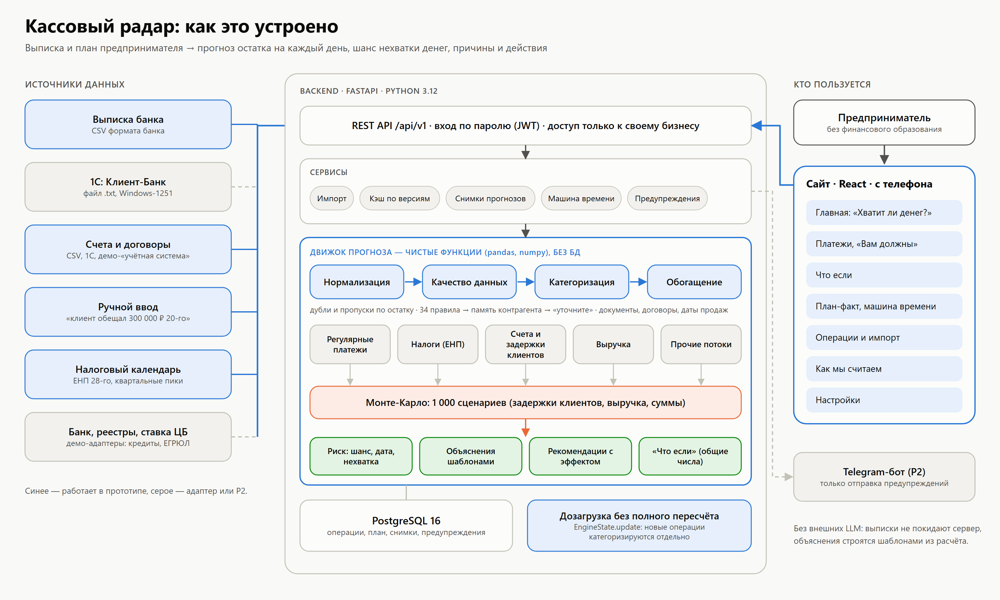

# Кассовый радар

**Хватит ли денег на обязательные платежи? А если нет — когда, сколько, почему и что сделать.**

Сервис для владельца малого бизнеса (без финансового образования): берёт выписку из банка и план («клиент обещал 300 000 ₽ 20-го»),
прогнозирует остаток на каждый день, заранее предупреждает о кассовом разрыве и подсказывает действия с эффектом
(«шанс нехватки 55% → 8%»). Кейс «Сервис финансового прогнозирования для малого бизнеса», банк «Центр-инвест», хакатон РнД, осень 2026.



## Что умеет

| Вопрос предпринимателя | Где ответ |
|---|---|
| Хватит ли денег в ближайший месяц? | **Главная**: светофор, фраза-вывод, три числа, график остатка с коридором «хуже/лучше обычного» |
| Когда и на сколько не хватит? Насколько это вероятно? | Главная: дата, сумма, шанс; красная зона ниже неснижаемого остатка |
| Хватит ли на зарплату 10-го и налоги 28-го? | «Платежи, которые нельзя пропустить»: «хватит с вероятностью N%» |
| Почему? Что мне сделать? | «Почему так» и «Что можно сделать» — каждое действие с эффектом на шанс |
| Кто мне должен и когда заплатит? | **Платежи → Вам должны**: открытые счета, «обычно платит через 18±6 дн.», просрочки |
| А если клиент задержит оплату или выручка упадёт? | **Что если**: четыре сценария и ползунок, график «как сейчас» против «если…» |
| Я знаю, что будет X | **Добавить событие**: прогноз пересчитывается сразу |
| Сбылся ли прогноз? | **План-факт** и «машина времени» (демо): что пришло, что нет, предупреждения |
| Можно ли этому верить? | **Как мы считаем**: бэктест по датам без утечек, надёжность вероятностей |

## Запуск для жюри (≈10 минут)

Нужны Docker Desktop (Compose v2, ≥4 ГБ памяти для Docker) и датасет `cashflow_dataset_participants.zip`
(материалы кейса, в репозитории его нет). `make` не обязателен — ниже есть команды без него.

```bash
git clone https://github.com/Kiboiko/cashflow-forecast && cd cashflow-forecast

# 1. Датасет → data/raw (companies.csv, all_operations.csv, statements/)
make data                       # архив лежит в корне репозитория; без make — просто распакуйте его в data/raw

# 2. Всё поднимается одной командой (первая сборка 5–8 минут)
docker compose up --build -d

# 3. Демо-предприниматели и их выписки (несколько минут: движок один раз разбирает все 222 тысячи операций)
make seed                       # без make: docker compose exec api python scripts/seed_demo.py
```

Откройте **http://localhost:8080** и нажмите на карточку предпринимателя — вход без пароля. Всё это те же аккаунты,
которые можно открыть и по паролю:

| Предприниматель | Бизнес | Почта | Пароль |
|---|---|---|---|
| Ирина | C064, образовательный центр для детей (ИП) — сезонность, зарплата и аренда летом | `irina@example.com` | `demo1234` |
| Олег | C109, грузоперевозки (ООО) — B2B-клиенты с задержками, «Вам должны», «что если клиент задержит оплату» | `oleg@example.com` | `demo1234` |
| Анна | C107, кофейня (ООО) — выручка по картам и СБП каждый день | `coffee@example.com` | `demo1234` |

Данные у всех видны **до 31.07.2026**. Остальные дни выписки загружены, но скрыты: их подгружает «машина времени»
(План-факт → «+7 дней»). Вернуть демо в начало: кнопка «К началу демо» или `make demo-reset`.

**Любая из 150 компаний.** На экране входа под карточками есть свёрнутый блок «Для жюри»: выберите компанию из датасета, и она
откроется как отдельный предприниматель (данные видны до 31.07.2026, остальное подгружает «машина времени»). Первый вход в компанию
занимает до минуты — загружаем её выписку и считаем прогноз, дальше открывается сразу. Чтобы прогноз по этим компаниям был таким же
точным, как у трёх персон, один раз выполните `make seed-jury` (без make: `docker compose exec api python scripts/seed_demo.py --jury`):
скрипт считает для всех компаний контекст «со стороны» (несколько минут), выписки при этом не загружаются.

Swagger с описанием API: http://localhost:8080/docs. Остановить: `docker compose down` (данные сохраняются),
стереть всё: `docker compose down -v`.

> Схема БД создаётся при старте без миграций. Если после обновления кода API пишет про отсутствующую колонку —
> `docker compose down -v`, затем снова `up --build` и `make seed` (данные демо восстанавливаются из датасета).

## Контрольный датасет (финальный чек-поинт)

Одна команда считает прогноз и метрики на любом датасете того же формата (zip, папка или одна выписка):

```bash
cd backend && uv run python scripts/evaluate.py --data ../control.zip --publish --prepare-service ../data/control
```

Результат — `reports/control/<датасет>/`: пошаговый журнал проверки и журнал расчёта прогноза по компаниям, Accuracy, Precision, Recall, F1, матрицы ошибок, MAE, MSE, RMSE, ROC-AUC, Brier, графики «прогноз против факта» и прогноз на 30 дней от последней даты. Как открыть эти компании в интерфейсе и что где показывать — [docs/CHECKPOINT.md](docs/CHECKPOINT.md).

## Показ за 4 минуты

1. **Ирина → Главная.** Светофор и фраза («… может не хватить около … ₽ на зарплату и аренду. Шанс — …»), причины: летний спад выручки + зарплата и аренда.
2. **«Что можно сделать» → «Как это изменит прогноз»** — эффект «шанс 55% → 8%».
3. **«Платежи, которые нельзя пропустить»** — «аванс 25 августа: хватит с вероятностью N%».
4. **Выйти → Олег → Платежи → Вам должны**: клиенты, их обычная задержка и просрочки. **Что если → «Клиент заплатит позже»** — разрыв раньше и на большую сумму.
5. **Платежи → «Добавить событие»**: «Клиент обещал оплатить 300 000 ₽ 20 августа» — прогноз пересчитан.
6. **План-факт → «+7 дней» дважды**: что пришло, чего нет, предупреждение «не пришла оплата от …», обновлённый прогноз.
7. **Как мы считаем** — таблица бэктеста и диаграмма «если мы говорим 30%, так и бывает».

## Как это устроено

- **Структурная модель + Монте-Карло.** Зарплата, аренда, кредиты и ЕНП известны по календарю точнее любой нейросети — их прогнозируем правилами, выученными из истории
  (с переносами выходных и праздников). Выручку (карты, СБП, маркетплейсы) и нерегулярные потоки — статистикой с сезонностью. Оплаты клиентов — по профилю задержки конкретного клиента.
  Тысяча сценариев даёт честные дату, сумму и шанс разрыва; шанс откалиброван.
- **Деньги владельца не прогнозируем.** Займ учредителя, перевод со своего счёта, транш кредита — реакция на разрыв: прогноз показывает разрыв, который владелец иначе закрыл бы сам.
- **Объяснения — шаблонами, без LLM.** Выписки — чувствительные данные: во внешние сервисы они не уходят.
- **Движок — чистые функции** (`backend/app/engine`, без БД и FastAPI): один код для API, тестов и бэктеста, детерминизм по seed.
- **Обновление без полного пересчёта.** Новые операции категоризируются отдельно (`EngineState.update`).
- Подробная спецификация — [docs/ARCHITECTURE.md](docs/ARCHITECTURE.md), подключение движка к сервису — [docs/ENGINE_API.md](docs/ENGINE_API.md).

### Качество прогноза

Бэктест без утечек (модели видят только данные ≤ даты отсечки), сравнение подходов (наивный, сезонно-наивный, структурный, +ML, +внешние данные),
метрики остатка и обнаружения разрывов, надёжность вероятностей — в [reports/backtest.md](reports/backtest.md).
Те же цифры показывает страница «Как мы считаем» (читает свежий `reports/backtest_<дата>.json`).

## Подключения и интеграции

| Что | Как работает | Статус |
|---|---|---|
| Выписка банка, CSV | Операции → «Загрузить выписку»: формат датасета (`;`, UTF-8 или Windows-1251); повторная загрузка не создаёт копий | работает |
| Выписка в формате 1С «Клиент-банк» | Тот же экран принимает файл `1CClientBankExchange` (UTF-8, Windows-1251, DOS); выгрузка из датасета в этот формат — `backend/scripts/export_1c.py` | работает |
| Счета и договоры, CSV | Платежи → «Вам должны» → загрузить файл; заменяет данные демо-«учётной системы», оплаченные по выписке счета не показываются | работает |
| Демо-«учётная система» | У Олега открытые счета восстановлены из назначений платежей; в интерфейсе подписано «демо» | демо |
| Telegram | Короткие предупреждения без сумм, названий и ИНН; Настройки → «Отправить тестовое сообщение»; нужен `TELEGRAM_BOT_TOKEN` и id чата | работает при токене |
| Ключевая ставка ЦБ | Настройки → «Справочно»: таблица со страницы ЦБ, кэш на 6 часов; нет сети — запасное значение с пометкой | работает |
| Проверка контрагентов по ИНН | Платежи → «Вам должны»: метка «Идёт ликвидация» и т. п. **Демо-заглушка**: наружу ничего не уходит, статусы берутся из `data/demo/registry_mock.json` | демо |

Чтобы на демо показать метку у клиента, создайте `data/demo/registry_mock.json` (файл перечитывается сам, перезапуск не нужен):

```json
{"<ИНН клиента из «Вам должны»>": {"status": "liquidating", "note": "Условный статус для демо"}}
```

Статусы: `liquidating` (ликвидация), `bankrupt` (банкротство), `unreliable` (недостоверные сведения). Остальные ИНН считаются действующими.

## Безопасность и приватность

- Вход по email и паролю (bcrypt), JWT на 12 часов, не более 5 попыток входа в минуту с адреса.
- Любой запрос к `/businesses/{id}/…` проверяет, что бизнес принадлежит пользователю; чужой — 404 (покрыто тестами).
- Логи — JSON, ИНН, номера счетов, email и токены маскируются на уровне фабрики записей; назначения платежей, имена контрагентов и суммы не логируются (тест после импорта).
- Загруженные файлы разбираются в памяти и не сохраняются. CORS — только адрес фронта, заголовки безопасности и CSP — в nginx.
- Секреты — в `.env` (не в git), образец — `.env.example`.
- Журнал nginx пишет только путь запроса, без параметров: в них бывают ИНН и текст поиска по операциям.
- Токен бота Telegram не попадает в журнал: библиотека запросов пишет адрес целиком, поэтому её сообщения приглушены, а токен в адресе маскируется (проверено тестом).
- Вход одним нажатием, режим жюри и «машина времени» — только при `DEMO_MODE=true`.

## Разработка

Нужны Python 3.12 + [uv](https://docs.astral.sh/uv/), Node 22, Docker.

```bash
cd backend && uv sync && uv run pytest -q     # тесты (часть пропускается без датасета в data/raw)
make test        # backend-тесты
make lint        # ruff + eslint + tsc
make types       # типы фронта из OpenAPI → frontend/src/api/types.gen.ts (файл коммитим)
make backtest    # пересчёт бэктеста → reports/

# без Docker: API на SQLite и фронт с прокси
cd backend && FORECAST_MODE=engine uv run uvicorn app.main:create_app --factory --reload
cd frontend && npm ci && npm run dev          # http://localhost:5173, /api → localhost:8000
```

Без датасета можно посмотреть интерфейс на готовом ответе движка: `FORECAST_MODE=fixture`.

| Переменная | Назначение | По умолчанию |
|---|---|---|
| `DATABASE_URL` | строка подключения SQLAlchemy | SQLite-файл (в Docker — PostgreSQL) |
| `JWT_SECRET` | секрет подписи токенов, ≥32 символов | значение для разработки |
| `DEMO_MODE` | вход персоны одним нажатием, машина времени | `true` |
| `FORECAST_MODE` | `engine` или `fixture` (готовый ответ) | `engine` |
| `CORS_ORIGINS` | адреса фронта через запятую | `localhost:8080`, `localhost:5173` |
| `TELEGRAM_BOT_TOKEN` | бот для предупреждений (необязательно) | пусто |
| `CBR_KEY_RATE_FALLBACK` | ключевая ставка, которую показываем, если сайт ЦБ недоступен | `0.14` |

**Windows и OneDrive.** Если репозиторий лежит в папке, которую синхронизирует OneDrive, `.venv` и `node_modules` (десятки тысяч файлов)
лучше держать вне неё: `$env:UV_PROJECT_ENVIRONMENT = 'C:\venvs\kassa-radar'`, а зависимости фронта ставить скриптом
`frontend/scripts/install-outside-onedrive.ps1`.

## Структура репозитория

```
backend/app/engine/    движок прогноза (человек A): чистые функции, без БД
backend/app/api/       REST-эндпоинты /api/v1
backend/app/services/  импорт, прогноз и кэш, снимки, машина времени, предупреждения, посев
backend/app/db/        модели SQLAlchemy и сессии
backend/scripts/       seed_demo.py, backtest.py, make_demo_plans.py, unpack_dataset.py …
backend/tests/         engine/ (движок), api/ (сервис, на синтетической выписке)
frontend/src/          React + TypeScript + Tailwind + ECharts: pages/, components/, api/, lib/
docs/                  ARCHITECTURE.md, ENGINE_API.md, diagrams/
reports/               бэктест (JSON, markdown, картинки)
data/                  raw/ — датасет (не в git), demo/ — сгенерированные счета
```

## Команда

- **A — «Движок и качество»**: прогноз, риск, рекомендации, «что если», план-факт, бэктест.
- **B — «Продукт»**: API, БД, интерфейс, интеграции, безопасность, запуск и демо.
