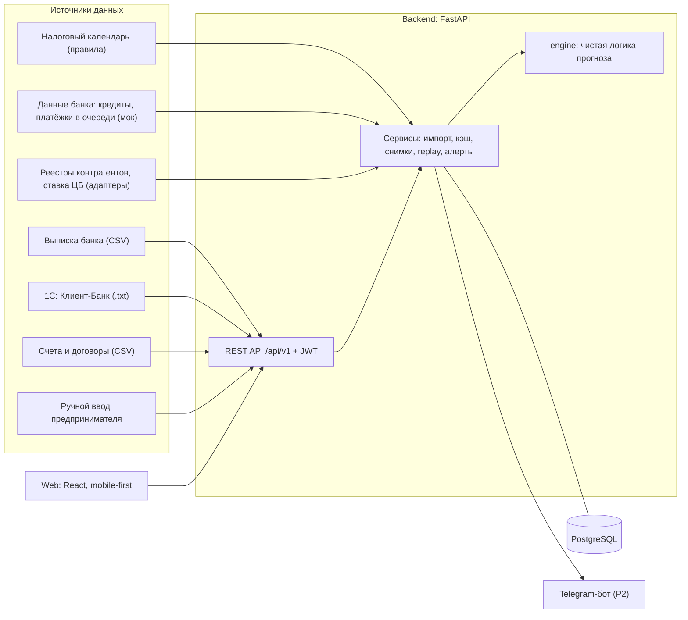
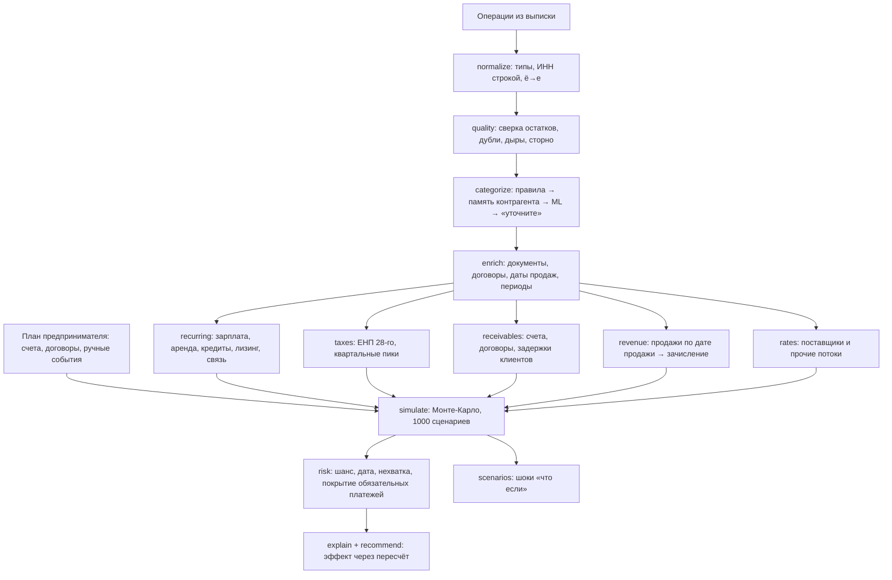
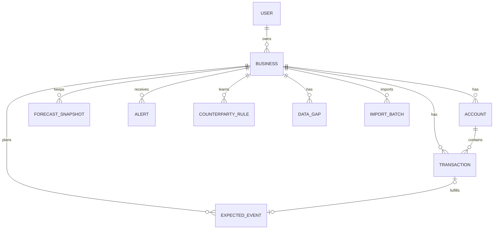

# Кассовый радар — архитектура и план работ

> **Кейс:** «Сервис финансового прогнозирования для малого бизнеса» · Банк «Центр-инвест» · Хакатон РнД, осень 2026 · Middle · 100 000 ₽
> **Для кого:** команда из 2 человек и Claude Code. Это единый источник правды: требования, факты о данных, архитектура, контракты, план.
> **Версия:** 1.0 от 23.10.2026. Рабочее название «Кассовый радар» можно поменять.

**Проверьте в первые 15 минут**

1. **Дедлайн — подтверждён: воскресенье 25.10.2026, 12:00.** Исходный план был рассчитан на сдачу в вс ~18:00; он сжат до ~37 часов (старт пт 23.10 ~22:40). **Решение команды: из плана ничего не вырезаем** — все 5 блоков и все P2 остаются; сжаты сон, запас и длительность блоков (§14.2). Если появятся обязательные чекпоинты менторов — двигайте контрольные точки.
2. **Где хранить код — подтверждено: GitHub, `Kiboiko/cashflow-forecast`** (SourceCraft не используем: в PDF кейса такого требования нет; у соседних кейсов организаторов оно было). Ссылку на репозиторий отправляем организаторам до дедлайна, репозиторий для жюри должен быть доступен (публичный или с выданным доступом).
3. **Датасет не коммитим** (~128 МБ распакованный). Кладём в `data/raw/`, папка в `.gitignore`.

---

## 0. Как работать с документом

- Положите файл в репозиторий как `docs/ARCHITECTURE.md`, а в корень — короткий `CLAUDE.md` из Приложения C: Claude Code читает его в каждой сессии.
- Задачи в §14 пронумерованы (A0…A13 — человек A, B0…B13 — человек B) и ссылаются на разделы. Промпт для Claude Code: «Прочитай docs/ARCHITECTURE.md §6.6 и §14, задача A5. Контракты из §8 не меняй».
- Приоритеты: **P0** — минимальные требования кейса (без них не примут), **P1** — сильно влияет на оценку, **P2** — если остаётся время.
- Все числа о данных в §3 посчитаны на выданном архиве `cashflow_dataset_participants.zip`. Если что-то не сходится — верьте данным и поправьте документ.

---

## 1. Кейс в одном экране

**Проблема.** Бизнес прибыльный, но через две недели зарплата, аренда и налоги, а крупные клиенты задерживают оплату — на счёте временно не хватает денег на обязательные платежи (кассовый разрыв). Владелец малого бизнеса узнаёт об этом в последний момент: финансы у него в выписках, таблицах и в голове.

**Цель.** Сервис анализирует историю операций, прогнозирует остаток на каждый день (не меньше 30 дней вперёд), заранее предупреждает о разрыве — когда, на сколько, с какой вероятностью и почему — и подсказывает, что сделать.

**Требования кейса → наше решение**

| Требование | Откуда | Как закрываем | P |
|---|---|---|---|
| Разбор и категоризация операций | осн. задача 1, мин. ТТ 2 | 34 правила (99,74% операций) → память контрагента → ML для пустых назначений → «уточните» у предпринимателя (§6.3) | P0 |
| Регулярные платежи и поступления, выставленные счета, налоги из внешних источников | осн. задача 2 | детектор регулярных платежей (§6.6), налоговый календарь ЕНП (§6.7), счета и договоры из CSV, 1С и ручного ввода (§6.8, §13) | P0 детектор и налоги, P1 счета |
| Прогноз остатка по дням ≥30 дней | осн. задача 3, мин. ТТ 1 | структурная модель потоков + Монте-Карло, горизонт 30/60/90 (§6.9–6.12) | P0 |
| Риск разрыва: дата, сумма, вероятность | осн. задача 4 | шанс, дата, нехватка (ожидаемая и в плохом сценарии), «подушка», покрытие каждого обязательного платежа (§6.13) | P0 |
| Понятный интерфейс для предпринимателя | осн. задача 5, мин. ТТ 4 | Главная «Хватит ли денег?»: график остатка + предупреждения простым языком (§9) | P0 |
| Модель прогноза с проверкой качества | мин. ТТ 3 | бэктест по точкам отсечки без утечки, метрики остатка и обнаружения разрывов (§7) | P0 |
| ★1 Договоры, счета, налоги | задача со звёздочкой | §6.7, §6.8, §13 | P1 |
| ★2 План-факт и автообновление прогноза | задача со звёздочкой | снимки прогнозов, сопоставление с фактом, алерт «не пришла оплата», «машина времени» (§6.17) | P1 |
| ★3 Негативные сценарии «что если» | задача со звёздочкой | 4 шока из кейса на одном графике с базой (§6.16) | P1 |
| ★4 Интеграции и ручной ввод | задача со звёздочкой, доп. ТТ 1 | 1С Клиент-Банк, CSV счетов и договоров, ручная форма, моки банка и реестров; источник виден у каждого события (§13) | P1/P2 |
| Обновление прогноза без полного пересчёта | доп. ТТ 2 | `EngineState.update()` (§6.17) | P1 |
| Граничные случаи и пропуски | доп. ТТ 3 | §12 | P1 |
| Сравнение подходов | доп. ТТ 4 | наивный / сезонно-наивный / структурный / +ML / +внешние данные (§7) | P1 |
| Схема архитектуры | доп. ТТ 5 | §4 (mermaid → PNG для слайда) | P1 |
| Тесты | доп. ТТ 6 | §11 | P1 |
| Безопасность | доп. ТТ 7 | вход по паролю, доступ только к своему бизнесу, маскирование логов (§10) | P1 |

**Критерии оценки жюри:** качество прогноза · заблаговременность и корректность выявления разрывов · какие доп. источники подключены и насколько улучшают прогноз · техническое качество и устойчивость к граничным случаям · презентация на реалистичном сценарии.

---

## 2. Предприниматель в центре

> Уточнение организаторов: «решение кейса предполагает, что конечный пользователь — предприниматель, он центр предметной области».

1. **Пользователь — владелец малого бизнеса** без финансового образования: ИП или директор ООО, 2–50 сотрудников, открывает сервис с телефона между делами. Не аналитик банка, не бухгалтер, не кредитный инспектор.
2. **Доменная модель строится от него:** `Предприниматель → его бизнесы → их счета → операции, обязательства, планы`. Каждый запрос к API ограничен бизнесами текущего пользователя. Экрана «150 компаний в таблице» в продукте нет: датасет — это 150 разных предпринимателей.
3. **Интерфейс отвечает на его вопросы, а не показывает модель:**

| Вопрос предпринимателя | Где отвечаем |
|---|---|
| Хватит ли денег в ближайший месяц? | Главная: светофор + одна фраза |
| Когда и на сколько не хватит? Насколько это вероятно? | Главная: дата, сумма, шанс; график с красной зоной |
| Почему? | 2–4 причины: какие платежи, какие поступления задержатся, сезонность |
| Что мне сделать? | 2–3 действия с эффектом: «шанс нехватки 64% → 8%» |
| Хватит ли на зарплату 10-го и налоги 28-го? | «Платежи, которые нельзя пропустить» с «хватит с вероятностью N%» |
| Кто мне должен и когда заплатит? | «Вам должны»: открытые счета, обычная задержка клиента |
| А если клиент задержит оплату или выручка упадёт? | «Что если» |
| Я знаю, что будет X | Быстрое добавление события, прогноз пересчитывается сразу |

4. **Язык:** «может не хватить денег», «ожидаемый остаток», «если всё пойдёт хуже обычного», «вам должны», «нужно заплатить». Термины (кассовый разрыв, P10/P90) — только в подсказках. Словарь — §9.3.
5. **Предприниматель — источник знаний.** Исправил категорию — правило запомнилось для контрагента. Добавил «клиент обещал 300 000 ₽ 20-го» — это учтено. Отметил «да, это регулярный платёж» — поток закреплён.
6. **Мы на его стороне.** Сначала бесплатные действия: попросить клиента оплатить, перенести платёж поставщику, перевести свои деньги из другого банка, отложить вывод на личную карту. Кредит или овердрафт — последним вариантом, с честной оценкой стоимости. Переносить налоги и зарплату не предлагаем никогда.
7. **Инсайт из данных, на котором держится питч:** у 81 из 150 компаний за 2 года были разрывы — 533 эпизода. В 415 из них минуса на счёте не было видно: дыру в тот же день закрывали займом учредителя, деньгами с другого своего счёта или траншем кредита. Перед займом учредителя остаток в медиане ≈7% от обычного. Мы показываем такие моменты заранее: «За год вы 4 раза докладывали свои деньги — в следующий раз узнаете за 2–3 недели».

---

## 3. Что мы знаем о данных

Формат: UTF-8 **с BOM**, разделитель `;`, даты `ГГГГ-ММ-ДД`, суммы с точкой, **ИНН читать строкой** (вымышленные ИНН начинаются с `00`). Поля: `company_id, operation_id, operation_date, amount (всегда > 0), direction (Поступление|Списание), counterparty_inn, counterparty_name, payment_purpose, balance_eod`. Остаток на начало первого дня = `balance_eod − поступления + списания` первого дня. Справочник `companies.csv`: название, ИНН, ООО/ИП, вид деятельности, первая и последняя дата, число операций.

### 3.1 Факты (посчитаны на датасете)

| Что | Значение |
|---|---|
| Масштаб | 150 компаний (94 ООО, 56 ИП), 15 отраслей; 222 420 операций (144 138 поступлений, 78 282 списаний); 01.10.2024 – 30.09.2026 |
| На компанию | 68 – 3 354 операций, медиана ≈1 500 |
| Короткая история | 22 компании без полного года (<13 мес.), 12 — меньше 6 мес., 4 — меньше 3 мес.; 7 закрыли счёт до 01.09.2026 |
| Пустые поля | назначение — 583 (0,26%), ИНН — 11 166 (5,0%) |
| Дубли | 21 лишняя копия строки. В 20 случаях скачок остатка в этот день ровно равен сумме дубля → **дубль удаляем, только если это подтверждает сверка остатка** |
| Сверка остатков | `balance_eod` одинаков внутри дня. ~100 дней, где `остаток ≠ вчера + приход − расход`: 44 — копейки (≤1 ₽), 20 — дубли, 35 — пропущенные операции (дыры в выгрузке) |
| Минус на счёте | 1 266 дней у 16 компаний, минимум −14,5 млн ₽. **У всех 16 есть проценты за овердрафт** → для них порог разрыва = −лимит овердрафта |
| Деньги владельца | займы, пополнения и взносы владельца — 253 операции, переводы со своих счетов в других банках — 261, транши кредитов — 37. Перед займом учредителя остаток в медиане ≈7% от обычного для компании |
| Эпизоды разрывов | 533 эпизода у 81 компании: 79 — минус на счёте, **415 — скрытые** (в тот же день пришли деньги владельца или кредит, без них был бы минус), 39 — и то и другое. После 01.04.2026 — 173 эпизода у 60 компаний (тестовая выборка) |
| Налоги | Все налоги идут через **ЕНП**: 3 924 платежа + 5 списаний по поручению налоговой. 2 443 — ровно 28-го; если 28-е выходной → следующий рабочий день (89% таких случаев). Индекс по месяцам: мар 1,64 · апр 1,59 · июл 1,61 · окт 1,35 · янв 0,59 · фев 0,37 · дек 0,58 — похоже на квартальные авансы и годовые платежи |
| Зарплата | 2 выплаты в месяц: аванс чаще 25-го (также 20-го, 15-го), расчёт 10-го (также 5-го, 30-го, 15-го). Если день выходной → **раньше**, на предыдущий рабочий день (89–96% случаев; ТК РФ ст. 136). Бывает одним реестром или переводом каждому сотруднику (до 8 в день) → агрегируем по дню |
| Аренда | 1–12 числа; если выходной → **позже** (783 из 784 случаев) |
| Карты и СБП | Зачисление на следующий рабочий день после даты продажи: лаг 1 день — 69%, 2–3 дня (выходные) — 28%, до 8 дней (праздники). Поэтому в понедельник операций в ~2,5 раза больше. Дата продажи есть в назначении: «Дата реестра ДД.ММ.ГГГГ» (карты), «за ДД.ММ.ГГГГ» (СБП) |
| Маркетплейсы | Еженедельные выплаты за 7-дневный период («за период с … по …»), приходят вт–чт |
| Гостиницы | Выплаты сервисов бронирования по агентскому договору раз в месяц, 8–15 числа |
| Оплаты клиентов (B2B) | У 89% из ~33,9 тыс. оплат в назначении есть дата документа (УПД, счёт, акт). Задержка оплаты: медиана 21 день, p90 60, максимум 210. У постоянных клиентов (≥5 оплат) разброс ≈12 дней → **задержку конкретного клиента можно предсказывать**. Частичные оплаты — 5,8% |
| Оплаты поставщикам | Через 9 дней после даты документа (медиана; p90 21) |
| Договоры (мебель) | 2 572 пары «предоплата → окончательный расчёт» по номеру договора: предоплата ≈57% суммы (p10 50%, p90 70%), расчёт через 35 дней (p10 23, p90 47) → **открытые договоры = известные будущие поступления** |
| Сезонность выручки (индекс месяца) | гостиницы: июл 2,15, фев 0,34 · агро: авг 3,04, сен 3,19, мар 0,08 · детские центры: июл 0,40, авг 0,45, сен 1,49 · стройка: май 1,59, дек 0,41 · маркетплейсы: дек 1,57, фев 0,73 · одежда: дек 1,42 |
| Календарь | Даты операций точно следуют производственному календарю РФ с переносами: нерабочие 30–31.12.2024, 02.05.2025, 08.05.2025, 13.06.2025, 03.11.2025, 09.01.2026 и др.; рабочие субботы 02.11.2024, 28.12.2024, 01.11.2025. Полный список — Приложение B |
| Наивный ориентир | «Остаток не изменится» на 30 дней: медианная относительная ошибка 0,21 (MAE / среднее \|остатка\| за 90 дней; 483 точки отсечки — концы мая–августа 2026). Фактический минус в следующие 30 дней — лишь в 22 точках из 483 → **без скрытых разрывов обнаружение проверять не на чем** |

### 3.2 Ловушки (каждую покрыть тестом)

1. **«налог» ≠ налог.** Фраза «Без налога (НДС)» стоит в 4 193 назначениях (≈11% платежей поставщикам, ≈14% платежей за аренду и услуги). Регулярка `налог` превращает их все в ложные налоги. ЕНП ловим только по `единый налоговый|енп`.
2. **«возврат» в эквайринге.** «…комиссия …, возврат покупки 0.00» — это выручка. Правило эквайринга стоит раньше правил возврата.
3. **«аванс»**: исходящий — аванс по зарплате, входящий — предоплата клиента. Правила зависят от направления.
4. **«Плата за аренду POS-терминалов»** — комиссия банка, а не аренда помещения. **«Обеспечительный платёж по договору аренды»** — разовый, а не ежемесячная аренда.
5. **«Перевод собственных средств»** в обе стороны — не выручка и не расход, а перемещение между своими счетами.
6. **«Возврат платежа: неверно указаны реквизиты получателя. Оплата по УПД №…»** (входящий) — вернулся наш ошибочный платёж поставщику. Пара «платёж + возврат» исключается из моделей.
7. **«Возврат гарантийного удержания»** (входящий, стройка) — отложенная оплата клиента, а не возврат.
8. **Числа в тексте** бывают `1 234.56`, `1234-56`, `34 000.00`; номер документа — `№ 279`, `№279`, `№ 12/3`, `счету 123`; дата — `от 19.08.2024`, `от 19.08.2024г.`
9. **Пустое назначение** чаще всего у «ПАО «Банк»» (251), «Физическое лицо» (73), «Казначейство России (ФНС России)» (15).
10. **Дыры в выгрузке:** после пропуска остаток «скачет». Нельзя учить модели на днях внутри дыры и нельзя считать скачок операцией.

---

## 4. Архитектура

### 4.1 Компоненты



### 4.2 Конвейер движка



### 4.3 Стек

| Слой | Выбор | Почему |
|---|---|---|
| Backend | Python 3.12, FastAPI, Pydantic v2, SQLAlchemy 2, Uvicorn | быстро; OpenAPI из коробки → типы для фронта |
| Расчёты | pandas, numpy, scikit-learn (`HistGradientBoostingRegressor`, `LogisticRegression`) | без тяжёлых зависимостей (не Prophet) |
| БД | PostgreSQL 16 в Docker; в тестах SQLite in-memory | тип колонок `JSON` (не `JSONB`), чтобы работало в обеих |
| Frontend | React 18 + TypeScript + Vite + Tailwind, ECharts (`echarts-for-react`), TanStack Query, react-router, dayjs (ru) | ECharts умеет коридор, зоны и маркеры событий |
| Контракты | `openapi-typescript` генерирует `frontend/src/api/types.gen.ts` из `/openapi.json` | фронт и бэк не расходятся |
| Окружение | `uv` (Python), `npm`, Docker Compose, Makefile | запуск одной командой для жюри |
| Качество кода | ruff, pytest, eslint | |
| Уведомления (P2) | Telegram Bot API (только отправка), SMTP | предприниматель живёт в мессенджере |

**Без внешних LLM.** Выписки — чувствительные данные; объяснения строим шаблонами из структурированных причин — это детерминированно, тестируемо и сильный аргумент по безопасности.

### 4.4 Структура репозитория

```
kassa-radar/
├── CLAUDE.md                     # короткие правила для Claude Code (Приложение C)
├── README.md                     # запуск одной командой, демо-логины, сценарий
├── docker-compose.yml            # db, api, web
├── .env.example                  # без секретов
├── Makefile                      # data, up, seed, test, lint, types, backtest, demo-reset
├── docs/
│   ├── ARCHITECTURE.md           # этот файл
│   └── diagrams/                 # PNG схем для презентации
├── data/                         # в .gitignore, кроме README.md
│   ├── raw/                      # companies.csv, all_operations.csv, statements/
│   └── demo/                     # сгенерированные счета/договоры, примеры 1С
├── backend/
│   ├── pyproject.toml, uv.lock, Dockerfile
│   ├── app/
│   │   ├── main.py               # фабрика FastAPI, CORS, роутеры
│   │   ├── config.py             # pydantic-settings из .env
│   │   ├── logging_setup.py      # JSON-логи + маскирование (§10)
│   │   ├── security.py           # JWT, bcrypt, current_user, require_business_owner
│   │   ├── schemas.py            # ★ КОНТРАКТЫ API (общая зона, §8)
│   │   ├── db/                   # base.py, models.py, session.py
│   │   ├── api/                  # auth, me, businesses, transactions, events, forecast,
│   │   │                         # scenarios, planfact, alerts, imports, demo, quality
│   │   ├── services/             # forecast_service.py (кэш, снимки), import_service.py,
│   │   │                         # replay_service.py, alert_service.py, notify.py
│   │   ├── integrations/         # client_bank_1c.py, plans_csv.py,
│   │   │                         # counterparty_registry.py, cbr_rate.py, telegram.py
│   │   └── engine/               # ★ чистая логика: без FastAPI и БД, только pandas/numpy
│   │       ├── types.py          # dataclasses (§6.0)
│   │       ├── io.py             # чтение CSV датасета
│   │       ├── normalize.py
│   │       ├── quality.py        # сверка остатков, дубли, дыры, сторно
│   │       ├── calendar_ru.py    # рабочие дни, правила сдвига
│   │       ├── categorize/       # rules.yaml, taxonomy.py, rules.py, memory.py, ml_fallback.py
│   │       ├── enrich.py         # документы, договоры, даты продаж, периоды
│   │       ├── recurring.py
│   │       ├── taxes.py
│   │       ├── receivables.py    # счета, договоры, профили задержек клиентов
│   │       ├── revenue.py
│   │       ├── rates.py          # поставщики и прочие нерегулярные потоки
│   │       ├── simulate.py       # Монте-Карло
│   │       ├── risk.py
│   │       ├── explain.py
│   │       ├── recommend.py
│   │       ├── scenarios.py
│   │       ├── planfact.py
│   │       ├── state.py          # EngineState + инкрементальное обновление
│   │       └── pipeline.py       # run_forecast(...) → ForecastResult
│   ├── scripts/                  # seed_demo.py, backtest.py, eda_facts.py,
│   │                             # make_demo_plans.py, export_1c.py, golden_set.py
│   └── tests/                    # engine/, api/, fixtures/
├── frontend/
│   ├── Dockerfile, nginx.conf    # сборка → nginx; /api проксируется в api:8000
│   └── src/
│       ├── api/                  # client.ts, types.gen.ts (генерируется)
│       ├── pages/                # Home, Payments, WhatIf, PlanFact, Operations,
│       │                         # Settings, HowItWorks, Login, DemoPersonas
│       ├── components/           # BalanceChart, RiskCard, ObligationsList, ...
│       └── lib/                  # format.ts (₽, даты), copy.ts (все тексты)
└── reports/                      # backtest_*.json, backtest.md, figures/*.png
```

### 4.5 Запуск

- `make data` — распаковать архив датасета в `data/raw/`.
- `make up` → `docker compose up --build`: `db` (postgres:16), `api` (uvicorn :8000), `web` (nginx :8080 → статика + прокси `/api`).
- `make seed` — создать демо-предпринимателей и загрузить их выписки (§15.2). Для «машины времени» данные персон грузятся до `as_of = 2026-07-31`, остальное подгружается шагами.
- `make test`, `make lint`, `make types` (типы фронта из OpenAPI), `make backtest` (отчёт в `reports/`), `make demo-reset`.
- Для жюри: `docker compose up --build && make seed` → http://localhost:8080, логины — в README.

### 4.6 Ключевые решения (для защиты)

1. **Структурная модель + ML там, где он полезен.** Зарплата, аренда, кредиты, ЕНП известны по календарю точнее любой нейросети — их прогнозируем правилами, выученными из истории. Выручку и нерегулярные потоки — статистикой и ML. Поэтому прогноз объясним предпринимателю построчно.
2. **Вероятности — через Монте-Карло**, а не на глаз: 1 000 сценариев задержек клиентов, колебаний выручки и сумм дают честные дату, сумму и шанс разрыва.
3. **Деньги владельца не прогнозируем.** Займ учредителя, перевод со своего счёта, транш кредита — это реакция на разрыв. Прогноз показывает разрыв, который владелец иначе закрывал бы сам. Это же даёт разметку скрытых разрывов для проверки качества.
4. **Engine — чистые функции.** Бэктест, API и тесты используют один и тот же код; детерминизм через seed.
5. **Сценарии сравниваем на общих случайных числах** (один seed): разница «до/после» — эффект действия, а не шум.

---

## 5. Доменная модель



| Сущность | Ключевые поля | Комментарий |
|---|---|---|
| `User` (предприниматель) | email, password_hash, display_name, telegram_chat_id | центр модели; в демо один пользователь = одна компания датасета |
| `Business` | owner_user_id, name, inn, legal_form, industry, settings (JSON), data_as_of | settings: `horizon_days=30`, `threshold=0` (неснижаемый остаток), `overdraft_limit=0`, `risk_yellow=0.10`, `risk_red=0.40`, `other_accounts=[{bank, balance}]`, `include_owner_withdrawals=true` |
| `Account` | business_id, bank_name, is_primary | основной — из выписки; другие — вручную, только остаток |
| `Transaction` | business_id, account_id, external_id, date, amount (Numeric 18,2), direction (+1/−1), counterparty_inn, counterparty_name, purpose, balance_eod, category, category_source (`user`/`rule`/`name_rule`/`memory`/`ml`/`unknown`), category_confidence, doc_type, doc_no, doc_date, contract_no, sales_date, flags (JSON: duplicate, reversal_pair_id, gap_adjacent), import_batch_id | индекс (business_id, date) |
| `DataGap` | business_id, start_date, end_date, unexplained_amount | из сверки остатков |
| `CounterpartyRule` | business_id, counterparty_key (ИНН или нормализованное имя), category, source (`user`/`memory`) | исправления предпринимателя |
| `ExpectedEvent` | business_id, kind (`invoice_out`/`bill_in`/`contract`/`manual`/`tax`/`bank_internal`), source (`csv`/`1c`/`manual`/`demo_accounting`/`contract_detected`/`tax_calendar`/`bank_mock`), direction, amount, expected_date, due_date, doc_no, doc_date, counterparty_inn, counterparty_name, title, probability, mandatory, status (`planned`/`fulfilled`/`partially`/`overdue`/`cancelled`), matched_transaction_id, meta (JSON) | план предпринимателя и внешние источники. Регулярные платежи не храним — вычисляем (закрепление пользователем — P2) |
| `ForecastSnapshot` | business_id, as_of, horizon, params_hash, model_version, payload (JSON: daily, events, risk) | для план-факта |
| `Alert` | business_id, type, severity, key, title, body, payload, created_at, acknowledged_at, sent_channels | `key` — для дедупликации |
| `ImportBatch` | business_id, source (`dataset_csv`/`1c`/`replay`/`seed`), filename, stats (JSON) | |

---

## 6. Движок прогноза (`backend/app/engine`)

### 6.0 Типы (`types.py`)

```python
Direction = Literal[1, -1]          # +1 поступление, −1 списание

@dataclass
class RecurringStream:
    key: str                        # "salary:final" | "rent:0012345678" | ...
    category: str
    direction: Direction
    period: Literal["monthly", "weekly", "quarterly"]
    anchor_day: int                 # номинальный день месяца (для weekly — день недели 0–6)
    shift_rule: Literal["prev", "next"]   # куда сдвигать с нерабочего дня
    amount: float
    amount_cv: float                # неопределённость суммы
    last_date: date
    active: bool
    confidence: float               # 0..1 → бейдж «точно / вероятно / возможно»
    mandatory: bool
    counterparty: str | None
    explain: str                    # «платите 10-го последние 6 мес., сумма ≈ медиана 3 выплат»

@dataclass
class PlannedEvent:                 # регулярный платёж, счёт, договор, налог, ручное событие
    id: str
    direction: Direction
    amount: float
    date: date | None               # фиксированная дата ИЛИ
    date_pmf: list[tuple[date, float]] | None   # распределение даты (счета клиентов)
    p_within_horizon: float         # вероятность, что событие случится в горизонте
    amount_cv: float
    category: str
    title: str
    source: str
    mandatory: bool
    counterparty: str | None
    explain: str

@dataclass
class ForecastResult:               # сериализуется в ForecastResponse (§8)
    as_of: date
    horizon: int
    start_balance: float
    threshold: float
    dates: list[date]
    p10: np.ndarray
    p50: np.ndarray
    p90: np.ndarray
    inflow_p50: np.ndarray
    outflow_p50: np.ndarray
    prob_below: np.ndarray          # P(остаток < порога) по дням
    events: list[PlannedEvent]
    risk: "RiskAssessment"
    recommendations: list["Recommendation"]
    data_quality: "DataQuality"
    model_info: dict
```

Главная функция:

```python
def run_forecast(ops: pd.DataFrame, as_of: date, settings: Settings,
                 planned: list[PlannedEvent], horizon: int = 30,
                 n_paths: int = 1000, seed: int | None = None,
                 shocks: list[Shock] | None = None) -> ForecastResult: ...
```

`seed` по умолчанию — стабильный хэш `(business_id, as_of)`. **Все модели обучаются только на операциях с датой ≤ as_of.**

### 6.1 Импорт и нормализация (`io.py`, `normalize.py`)

- Датасет: `pd.read_csv(path, sep=";", encoding="utf-8-sig", dtype={"counterparty_inn": str, "company_id": str, "operation_id": str})`.
- `direction` → +1/−1; `purpose_norm` = нижний регистр, `ё→е`, схлопнуть пробелы; `cp_key` = ИНН, иначе нормализованное имя.
- 1С Клиент-Банк — §13. На выходе любого импорта один и тот же DataFrame.

### 6.2 Качество данных (`quality.py`)

1. **Сверка остатков** по дням: `expected = вчерашний balance_eod + Σприход − Σрасход`, `diff = balance_eod − expected`. |diff| ≤ 1 ₽ — округление, игнорируем.
2. **Дубли.** Кандидаты — совпадают дата, сумма, направление, ИНН, имя, назначение. Удаляем копию, **только если после удаления diff дня становится ≈0**; иначе оставляем (бывают честные одинаковые платежи).
3. **Дыры.** Оставшиеся |diff| > 1 ₽ → `DataGap(start = предыдущий день с данными, end = день, unexplained_amount = diff)`. Дни дыры ±3 дня помечаем `gap_adjacent` и не используем для обучения потоковых моделей. Предпринимателю: «В выписке нет данных за 12.03–02.04 — этот период не учитывается в прогнозе».
4. **Сторно.** Входящий «Возврат платежа: неверно указаны реквизиты… Оплата по УПД № N от D» → ищем исходящий платёж с тем же документом и суммой за 14 дней до → пара получает `reversal_pair_id` и исключается из моделей.
5. **Статус истории:** `short_history` (<90 дней), `no_full_year` (<13 мес.), `inactive` (нет операций >20 рабочих дней до as_of).

### 6.3 Категоризация (`categorize/`)

Порядок (побеждает первое совпадение):

1. `CounterpartyRule` от предпринимателя (source=`user`).
2. Правила по назначению — `rules.yaml` (Приложение A): 34 правила, на датасете **99,74% операций**, все непустые назначения.
3. Правила по имени контрагента при пустом назначении: Казначейство/ФНС → ЕНП, «Банк» → комиссии.
4. Память контрагента: для пары (бизнес, ИНН) берём категорию, если она ≥95% среди ≥3 размеченных операций. Так закрывается большинство пустых назначений: у 85% из них пара (компания, ИНН) встречается с заполненным назначением, а 78% пар однозначны.
5. ML-добивка (P2): `TfidfVectorizer(analyzer="char_wb", ngram_range=(2, 4))` по имени контрагента + направление, log-сумма, день месяца → `LogisticRegression`; учим на размеченных правилами операциях всех компаний; принимаем при уверенности ≥0,6.
6. Иначе `unknown_in` / `unknown_out` + «уточните» в интерфейсе.

**Таксономия** (`taxonomy.py`): код → название в интерфейсе → группа → обязательный → метод прогноза.

| Код | Название в интерфейсе | Группа | Обяз. | Метод прогноза |
|---|---|---|---|---|
| revenue_card | Оплаты картой | выручка | | revenue: дата продажи → следующий рабочий день |
| revenue_sbp | Оплаты по СБП | выручка | | revenue: как карты |
| revenue_cash | Наличная выручка | выручка | | revenue: рабочие дни |
| revenue_marketplace | Выплаты маркетплейсов | выручка | | еженедельный поток |
| revenue_agent | Выплаты сервисов бронирования | выручка | | ежемесячный поток + сезонность |
| client_payment | Оплаты клиентов по счетам | выручка | | счета (§6.8) + регулярные клиенты + rates |
| client_prepayment | Предоплаты клиентов | выручка | | rates + договоры |
| insurance_in, subsidy_in | Страховые выплаты, субсидии | разовые | | не прогнозируем (только из плана) |
| refund_in | Возвраты ошибочных платежей | корректировки | | исключаем (пары) |
| own_transfer_in | Со своего счёта в другом банке | деньги владельца | | исключаем → рекомендация |
| owner_injection | Займ или взнос владельца | деньги владельца | | исключаем → сигнал скрытого разрыва |
| loan_in | Кредит (транш) | финансирование | | исключаем, если не в плане |
| salary | Зарплата | обязательные | ✔ | recurring ×2 (аванс, расчёт), сдвиг `prev` |
| tax_enp | Налоги (ЕНП) | обязательные | ✔ | taxes (§6.7), сдвиг `next` |
| tax_enforced | Взыскание налоговой | обязательные | ✔ | не прогнозируем; флаг риска |
| enforcement | Исполнительный лист | обязательные | ✔ | не прогнозируем; флаг риска |
| rent | Аренда | обязательные | ✔ | recurring, сдвиг `next` |
| loan_repayment | Кредиты, проценты, овердрафт | обязательные | ✔ | recurring |
| leasing | Лизинг | обязательные | ✔ | recurring |
| utilities | Коммунальные услуги | обязательные | ✔ | recurring, сумма по сезону |
| rent_deposit | Обеспечительный платёж | разовые | | исключаем |
| capex | Оборудование и авто | разовые | | исключаем, если не в плане |
| telecom_it | Связь, интернет, ПО | операционные | | recurring |
| bank_fees | Комиссии банка | операционные | | recurring |
| suppliers | Поставщики | операционные | | rates (привязка к выручке — P2) |
| contractors | Подрядчики и ГПХ | операционные | | rates или recurring |
| logistics | Топливо, дороги, перевозки | операционные | | rates |
| marketing | Реклама | операционные | | rates (можно отложить) |
| services | Бухгалтерия, уборка, охрана, ремонт | операционные | | recurring или rates |
| owner_withdrawal | Вывод владельцу, дивиденды | деньги владельца | | исключаем; регулярный — переключатель «учитывать» |
| own_transfer_out | На свой счёт в другом банке | деньги владельца | | исключаем |
| owner_loan_repayment | Возврат займа владельцу | деньги владельца | | исключаем (можно отложить) |
| refund_out | Возвраты | корректировки | | исключаем |
| unknown_in / unknown_out | Не распознано | — | | rates «прочее» |

`EXCLUDED_FROM_MODEL` = деньги владельца, финансирование (кроме погашений кредитов и лизинга), разовые, корректировки, взыскания. **Этот же список используется в бэктесте (§7).**

### 6.4 Обогащение (`enrich.py`)

Регулярки по `purpose_norm` (после `ё→е`):

- документ: `(?:упд|счет[ау]?|акт[ау]?)\s*№?\s*([\w/-]+)\s*от\s*(\d{2}\.\d{2}\.\d{4})` → doc_type, doc_no, doc_date;
- договор: `договор[ау]?\s*№\s*([\w/-]+)(?:\s*от\s*(\d{2}\.\d{2}\.\d{4}))?` → contract_no;
- дата продажи: карты `дата реестра (\d{2}\.\d{2}\.\d{4})`, СБП `за (\d{2}\.\d{2}\.\d{4})`;
- период маркетплейса: `с (\d{2}\.\d{2}\.\d{4}) по (\d{2}\.\d{2}\.\d{4})`;
- подвид зарплаты: `advance`, если есть «аванс», иначе `final`.

Покрыть тестами все написания из §3.2 п. 8.

### 6.5 Производственный календарь (`calendar_ru.py`)

- `is_workday(d)`: будни минус праздники плюс рабочие субботы. Списки — Приложение B (окт 2024 – сен 2026 сверены с датасетом; IV квартал 2026 — по официальному календарю: 04.11 и 31.12 нерабочие).
- `shift(d, rule)`: `next` — вперёд до рабочего дня, `prev` — назад.
- `nominal_date(year, month, day)`: если в месяце нет такого числа — последний день месяца.
- Правила сдвига (подтверждены данными, §3.1): зарплата — `prev`; ЕНП, аренда, коммуналка, связь, кредиты, лизинг — `next`.
- Горизонт после 31.12.2026 в демо не нужен; календарь 2027 подгрузить из официального источника, когда понадобится.

### 6.6 Регулярные платежи (`recurring.py`)

Кандидаты: salary, rent, utilities, telecom_it, bank_fees, loan_repayment, leasing, services, contractors, marketing, revenue_agent, client_payment (регулярные клиенты), owner_withdrawal (для переключателя). Ключ потока — `(category, cp_key, подвид зарплаты)`.

Для ключа на данных за 13 месяцев до as_of, без дней дыр:

1. Суммы по дням (выплаты отдельным сотрудникам → один платёж дня).
2. Нужно ≥3 платежей. Медианный интервал 25–35 дней и платежи в ≥4 из последних 6 месяцев → `monthly`; 6–8 → `weekly`; 85–95 → `quarterly`.
3. `anchor_day` — мода дня месяца по тем месяцам, где этот день рабочий (так переносы с выходных не портят оценку).
4. Сумма — медиана 3 последних; `amount_cv` — CV 6 последних (clip 0,02–0,5). Коммуналка: при наличии того же месяца год назад — учесть сезон.
5. `active = (as_of − last_date) ≤ 1,5 × период`. Неактивные (кредит погашен, ушёл ключевой клиент) не прогнозируем, но сообщаем: «ООО X не платит 60 дней — исключили из прогноза».
6. `confidence` = доля месяцев с платежом × (1 − CV).
7. Развёртка в горизонт: `shift(nominal_date(y, m, anchor_day), shift_rule)` → `PlannedEvent(source="recurring")`. Если платёж текущего периода уже прошёл до as_of — не дублировать.

### 6.7 Налоги: ЕНП (`taxes.py`)

- Дата — 28-е → `shift(next)`. Если у компании 2–3 платежа в месяц — суммируем в один на 28-е (упрощение, честно назвать).
- Сумма месяца m:
  - есть тот же месяц год назад: `сумма = сумма(m, год назад) × g`, `g = clip(Σ 3 последних мес. / Σ тех же 3 мес. год назад, 0.5, 2.0)`;
  - нет: `median(3 последних «обычных» месяца) × Q[m] / median(Q[обычные])`, где `Q` — индекс месяцев по всем компаниям на данных ≤ as_of (≈ мар 1,64, апр 1,59, июл 1,61, окт 1,35).
- Неопределённость — CV по истории (clip 0,1–0,4).
- Если в апреле/июле/октябре налог у компании в >1,3 раза выше обычного — пояснение: «В октябре налог обычно выше — похоже на авансовый платёж по УСН. Оценка по вашей истории». Режим налогообложения не утверждаем: в данных его нет.
- Взыскания налоговой и исполнительные листы не прогнозируем; если были за 90 дней — флаг риска «есть долг, возможны списания без вашего участия».
- Для «живого» прогноза от 30.09.2026: ЕНП 28.10 заметно выше сентябрьского — хороший пример на демо.

### 6.8 Счета, договоры, задержки клиентов (`receivables.py`)

**Профиль задержки клиента.** Для входящих оплат с doc_date: `delay = дата оплаты − doc_date`. Профиль — эмпирическая выборка задержек клиента при ≥5 оплатах; иначе по всем клиентам компании; иначе по отрасли (всё на данных ≤ as_of). Плюс доля частичных оплат.

**Открытый счёт клиенту** (из CSV, 1С, ручного ввода или демо-учётной системы). Возраст `a = as_of − doc_date`. Дата оплаты = `shift(doc_date + delay, next)`, где `delay` берём из задержек клиента при условии `delay > a` (+ шум ±2 дня). Если `a` больше всех исторических задержек → «просрочен по меркам клиента»: шанс оплаты в горизонте 0,5 (настройка), дата равномерно в ближайшие 30 дней, алерт и рекомендация «напомнить». В горизонт попадает часть массы → `p_within_horizon`.

**Оплаты клиентов без данных учётной системы — модель «выставление × задержка»** (P1). Платежи клиентов в горизонте = счета, выставленные до as_of и ещё не оплаченные, + счета, которые будут выставлены. Ожидаемая оплата в день t:
`Σ_u R_u × f(t − u)`, где `R_u` — сумма счетов, выставленных в день u (оцениваем по оплаченным документам с doc_date ≤ as_of − 120 дней, когда почти всё уже оплачено; × сезонность), `f` — распределение задержек. Для u ≤ as_of берём только неоплаченную часть: `R_u × (F(t − u) − F(as_of − u))`. При подключённом источнике счетов прошлую часть заменяем явными счетами — это и есть прирост качества от внешних данных. Фоллбэк P0 — `rates` (недельный бутстрэп).

**Договоры с предоплатой** (мебель и похожие). Есть «Предоплата по договору № K», нет «Окончательный расчёт по договору № K» до as_of → ожидаемый расчёт `= предоплата × (1 − s) / s`, s — медианная доля предоплаты компании (≈0,57); дата — по распределению лагов компании (медиана 35 дней) при условии прошедшего времени. Источник `contract_detected`.

**Счета поставщиков** (входящие): дата оплаты = doc_date + типичная задержка компании (медиана 9 дней) или due_date из CSV. Не обязательные → кандидаты на перенос в рекомендациях.

**Демо-источник «учётная система»** (`scripts/make_demo_plans.py`, P1). Для выбранного as_of восстанавливаем документы, у которых `doc_date ≤ as_of`, а первая оплата `> as_of`; сумма = сумма всех оплат по документу. Это имитация 1С/ЭДО: модель видит только номер, дату и сумму документа, **дату оплаты — нет**. В интерфейсе и на слайде честно подписываем «демо-данные учётной системы, восстановлены из выписки». Отсюда же — открытые договоры. Это абляция «+внешние данные» в §7 (критерий 3).

### 6.9 Выручка (`revenue.py`)

Восстанавливаем ряд **по дате продажи**, а не зачисления:

- карты — дата из «Дата реестра», СБП — из «за ДД.ММ.ГГГГ» (включая выходные); суммы — чистые зачисления;
- наличные — по дате взноса (только рабочие дни);
- маркетплейсы — недельный ряд по периоду «с … по …», день выплаты — мода дня недели у компании;
- сервисы бронирования — месячный ряд, выплата 8–15 числа.

**M0 — сезонно-наивная** (бейзлайн): среднее того же дня недели за 4 последние недели.

**M1 — декомпозиция** (делаем первой, P0):
`ŝ(d) = level × weekday[w(d)] × season(month(d)) / season(month(as_of))`

- `level` — среднее продаж в день за последние 28 дней;
- `weekday[w]` — медиана отношения «день / среднее недели» за 8 недель; праздник = профиль воскресенья;
- `season` — индекс месяца компании, если есть тот же месяц год назад, иначе отраслевой (пул компаний отрасли на данных ≤ as_of). Короткая история — только отраслевой (холодный старт).

**M2 — глобальный бустинг** (P2): `HistGradientBoostingRegressor` по всем компаниям; цель `log1p(продажи / масштаб компании)`; признаки: день недели, праздник, месяц, день месяца, отрасль, отношения последних 7/28 дней, тот же день год назад, горизонт h. Обучение на точках отсечки до as_of. Сравнить с M1 в бэктесте, оставить лучшее по отрасли.

**Зачисление:** продажи дня d → `shift(d + 1 день, next)` (подтверждено лагами в данных); маркетплейс — в день выплаты недели.

**Неопределённость:** множитель уровня на сценарий (выборка из ошибок 30-дневной суммы на прошлых отсечках компании, при нехватке — отраслевых) × дневной шум (бутстрэп остатков по дню недели).

### 6.10 Прочие потоки (`rates.py`)

Поставщики, подрядчики, логистика, реклама, нераспознанное: недельные суммы за 12 недель (без дыр) → на сценарий выбираем недельную сумму бутстрэпом (× сезонный индекс отрасли) → раскладываем по дням недели по профилю компании. P2: для розницы и общепита поставщики = доля от прогноза выручки со сдвигом на медианную задержку оплаты поставщику.

### 6.11 Деньги владельца и финансирование

Не прогнозируем (`EXCLUDED_FROM_MODEL`). Используем: (1) для рекомендаций — «вы 3 раза переводили деньги со счёта в Банк-4, можно и сейчас»; (2) для инсайта — «вы закрывали нехватку своими деньгами N раз»; (3) как разметку скрытых разрывов в бэктесте. Регулярный вывод владельцу (≥3 из 4 последних месяцев, похожие суммы) показываем переключателем «учитывать в прогнозе» (по умолчанию включён). Погашения кредитов и лизинга — обязательные регулярные платежи, их прогнозируем.

### 6.12 Сборка и Монте-Карло (`simulate.py`)

```python
def simulate(start_balance: float, dates: list[date], components: list[Component],
             n_paths: int, rng: np.random.Generator) -> np.ndarray:   # [N, H]
    flows = np.zeros((n_paths, len(dates)))
    for c in components:             # каждый компонент возвращает знаковую матрицу [N, H]
        flows += c.sample(dates, n_paths, rng)
    return start_balance + flows.cumsum(axis=1)
```

Компоненты: `FixedEvent` (дата; сумма × лог-нормальный шум; Бернулли(p)), `TimedEvent` (дата из `date_pmf`, вне горизонта → 0), `RecurringStream` → набор FixedEvent, `Revenue`, `Rates`, `InvoicePipeline`. Всё векторизовано; цель — <300 мс на 1 000 сценариев × 90 дней. Выход: P10/P50/P90 по дням, `prob_below[t] = mean(B[:, t] < threshold)`, P50 потоков по группам (для объяснений). Стартовый остаток — `balance_eod` на as_of (+ остатки других счетов, если предприниматель выбрал «считать все счета»).

`threshold = settings.threshold − settings.overdraft_limit` (по умолчанию 0). Если у компании есть проценты за овердрафт, а лимит не задан — подсказка «Похоже, у вас есть овердрафт — укажите лимит».

### 6.13 Риск кассового разрыва (`risk.py`)

На матрице сценариев `B[N, H]`:

- `gap_probability` — доля сценариев, где `min_t B < threshold` (шанс разрыва в горизонте);
- `possible_gap_date` — первый день с `prob_below ≥ 0,2`; `likely_gap_date` — первый день с `prob_below ≥ 0,5`;
- нехватка сценария = `max_t (threshold − B_t)⁺`; `shortfall_p50` — медиана по сценариям с разрывом («скорее всего не хватит»), `shortfall_p90` — 90-й перцентиль («в плохом сценарии»);
- `safe_buffer` — 90-й перцентиль нехватки по всем сценариям: «чтобы с вероятностью 90% обойтись без разрыва, нужно дополнительно ≈X ₽ к дате D»;
- `level`: зелёный — шанс < 0,10; жёлтый — 0,10–0,40; красный — ≥ 0,40 или `likely_gap_date` в ближайшие 7 дней (пороги — в настройках);
- **покрытие обязательных платежей**: для каждого обязательного события e — `P(B_{t_e−1} + приходы дня ≥ сумма e)` → «Зарплата 10 авг (412 000 ₽) — хватит с вероятностью 62%». Это главный вопрос предпринимателя.

Что такое «вероятность» (для слайда): доля из 1 000 смоделированных сценариев, в которых остаток хотя бы один день опускается ниже порога. Калибровку проверяем в бэктесте (§7).

### 6.14 Объяснения (`explain.py`)

Строим из структуры, без LLM. Окно — 7 дней до `possible_gap_date`:

- крупнейшие оттоки в окне (сначала обязательные) — дата, сумма, источник;
- ожидаемые притоки, которые с заметной вероятностью придут после разрыва (счета с поздним распределением дат);
- сезонность: выручка месяца против предыдущего по индексу;
- отличия от обычного: налог выше обычного, крупный разовый платёж из плана.

Шаблоны (тестируются):

- красный: «{дата} может не хватить около {нехватка} на {главные платежи}. Шанс — высокий ({p}%).»
- жёлтый: «Есть риск нехватки денег около {дата}: в плохом сценарии до {нехватка_p90}. Шанс — {p}%.»
- зелёный: «В ближайшие {H} дней денег хватает на все обязательные платежи. Самый низкий остаток — около {min_p50} ({дата}).»
- платёж: «{дата} — {название} ≈{сумма}» (+ «в октябре налог обычно выше»);
- клиент: «Оплата от {клиент} по {документ} ≈{сумма} скорее всего придёт {диапазон дат}: этот клиент обычно платит через {медиана}±{разброс} дн.»;
- сезон: «В {месяц} выручка обычно на {pct}% ниже, чем в {пред. месяц}.»

### 6.15 Рекомендации (`recommend.py`)

Генерируем кандидатов → для каждого пересчитываем симуляцию **на тех же случайных числах** → оставляем те, что дают эффект, сортируем по эффекту и «цене» для предпринимателя.

| Тип | Когда | Текст и эффект |
|---|---|---|
| `collect_receivable` | открытый счёт клиента, оплата вероятна после даты разрыва | «Попросите {клиент} оплатить {документ} ({сумма}) до {дата}» — оплата сдвинута до даты |
| `defer_supplier` | необязательные платежи поставщикам или рекламе в окне | «Договоритесь с {поставщик} перенести {сумма} с {дата} на {новая дата}» |
| `move_own_funds` | в истории были переводы со своих счетов или задан остаток другого счёта | «Переведите {сумма} со счёта в {банк} до {дата} — вы так делали {n} раз» |
| `postpone_withdrawal` | в окне запланирован вывод владельцу или возврат займа владельцу | «Отложите вывод {сумма} на личную карту до {дата}» |
| `credit_line` | всегда последним, если риск остаётся | «Овердрафт или кредитная линия на {safe_buffer} на {дни} дн. — ориентировочно {стоимость} при ставке {r}% годовых» (ставка — из настроек или адаптера ЦБ) |

Каждая рекомендация: `effect = {gap_probability_after, shortfall_p50_after}`. Переносить зарплату и налоги не предлагаем никогда.

### 6.16 Сценарии «что если» (`scenarios.py`)

Шоки применяются к компонентам до симуляции; сравнение — на общих случайных числах.

| Шок | Параметры | Реализация |
|---|---|---|
| `client_delay` | ИНН или «крупнейший клиент», 14–28 дней | сдвиг дат его счетов и регулярного потока |
| `revenue_drop` | 10–30%, с даты | множитель на `Revenue` и входящие `client_payment` |
| `one_off_expense` | сумма, дата, название | `FixedEvent` (обязательный — по выбору) |
| `fixed_cost_increase` | %, категории (аренда, поставщики) | множитель на соответствующие потоки |

Ответ: базовый и негативный прогноз на одном графике + дельты шанса, даты и суммы разрыва. Готовые кнопки: «Крупный клиент заплатит на 3 недели позже», «Выручка −20%», «Внеплановый расход 150 000 ₽», «Аренда и закупки +10%».

### 6.17 План-факт и инкрементальное обновление (`planfact.py`, `state.py`)

**Снимок.** Каждый прогноз с новым as_of сохраняется в `ForecastSnapshot` (P10/P50/P90 по дням, плановые события).

**Новые данные** (импорт или «машина времени»):

1. `EngineState.update(new_ops)`: нормализация, сверка, категоризация **только новых** операций (правила + память, без переобучения ML).
2. Сопоставление плана с фактом: событие e ↔ операция f, если совпадает направление и (ИНН или категория), `|сумма_f − сумма_e| ≤ max(10%, 1 000 ₽)` (частичная — от 30%), дата f в окне `[e.date − 5 дней, e.date + grace]`; grace: регулярные — 3 рабочих дня, счета — до p75 задержки клиента. Жадно, ближайшие по дате.
3. Несопоставленные события с истёкшим grace → `overdue` → алерт «Не пришла оплата {сумма} от {клиент}, ожидали к {дата}» → прогноз пересчитан с новым распределением.
4. Обновление состояния без полного переобучения: последний остаток, `level` выручки (экспоненциальное сглаживание по новым дням), last_date и суммы потоков, профили задержек клиентов. Полное переобучение — по кнопке, раз в 30 дней или при новой дыре в данных.
5. Пересимуляция с нового as_of. Замерить и показать на слайде время обновления против полного пересчёта (реальные цифры из замера).

**График план-факт:** по дням и неделям — план прихода и расхода (P50 из снимка) против факта; отклонения >20% и >10 000 ₽ подсвечены; список: исполнено / частично / просрочено / неожиданные операции.

**«Машина времени» для демо:** данные персон загружены до 31.07.2026; `POST /demo/businesses/{bid}/replay/advance {days}` подгружает следующие дни из датасета как новый импорт → шаги 1–5 → новые алерты. На защите вживую видно автообновление, план-факт и предупреждения.

**Алерты:** `gap_risk` (новый или уровень вырос), `mandatory_at_risk` (покрытие <80%), `missed_inflow`, `overdue_invoice`, `data_gap` (нет данных >5 рабочих дней), `needs_review` (нераспознанные операции). Дедупликация по `key` за 24 часа. Каналы: в приложении (P0), Telegram (P2), email (P2).

---

## 7. Проверка качества (`scripts/backtest.py`)

**Протокол.** Точки отсечки — концы месяцев. Настройка параметров — на отсечках 31.10.2025 … 28.02.2026; итоговые цифры — на 31.03 … 31.08.2026 (тест; ~170 эпизодов разрывов у 60 компаний). Компании — все, у кого ≥90 дней истории до отсечки и есть 30 дней после. Горизонт 30 дней (дополнительно 7 и 14). На каждой отсечке модели видят только данные ≤ as_of. В бэктесте `n_paths = 300` и параллелизм по компаниям (joblib): полный прогон ≤15 минут.

**С чем сравниваем — «операционный остаток».** Модель намеренно не прогнозирует деньги владельца и разовые операции (§6.3), поэтому цель:
`B_op(t) = B_факт(t) − Σ_{as_of < s ≤ t} (исключённые потоки со знаком)`.
Если владелец 25-го внёс 300 000 ₽, чтобы выплатить зарплату, у `B_op` 25-го будет минус — это скрытый разрыв, который мы должны были предсказать. Для честности ошибку против фактического остатка тоже показываем.

**Метрики**

| Что | Метрика |
|---|---|
| Точность остатка | rel-MAE = mean_t \|P50_t − B_op(t)\| / max(среднее \|остатка\| за 90 дней до отсечки, 10 000 ₽); медиана и среднее по точкам; разрез по отраслям |
| Потоки | WAPE недельных сумм по группам (выручка, зарплата, ЕНП, поставщики) — видно, где ошибаемся |
| Интервалы | доля дней, где B_op внутри [P10, P90] (цель ≈80%); диаграмма надёжности для `gap_probability` |
| Обнаружение разрыва | y = 1, если min B_op < порога в горизонте. ROC-AUC и PR-AUC по `gap_probability`; precision и recall при пороге «жёлтый»; заблаговременность (дней от отсечки до фактического разрыва у пойманных); ошибка даты (дни); ошибка суммы нехватки |

**Сравнение подходов (таблица для слайда)**

| Подход | Что это |
|---|---|
| Наивный | остаток не меняется (ориентир: медианная rel-MAE ≈0,21 против факта, §3.1) |
| Сезонно-наивный | повторить чистые потоки последних 4 недель |
| Структурный | регулярные платежи + ЕНП + календарь + выручка M1 + rates |
| Структурный + ML | выручка M2 вместо M1 (бустинг по картам; в продукт не включён, см. §7.1) |
| + внешние данные | + открытые счета и договоры (демо-учётная система) — абляция для критерия 3 |

**Без утечек:** отраслевые индексы, индекс ЕНП, профили клиентов — только по данным ≤ as_of; восстановленные счета — только с doc_date ≤ as_of и без даты оплаты.

**Выход:** `reports/backtest_<дата>.json` (метрики по подходам, отраслям, горизонтам), `reports/figures/*.png` (сравнение подходов, диаграмма надёжности, пример «прогноз против факта»), `reports/backtest.md` — таблица для слайда. Страница «Как мы считаем» читает JSON через `GET /api/v1/quality/backtest`.

**Качество категоризации:** `scripts/golden_set.py` выбирает ~250 операций (стратифицированно по категориям, из 20 компаний) → ручная разметка (1 час вдвоём) → precision и recall по категориям, одной строкой на слайд.

### 7.1 Что получилось на бэктесте и чем реализация отличается от плана

Полные цифры — `reports/backtest.md`; подключение — `docs/ENGINE_API.md`. Тест: 765 точек, 143 компании, горизонт 30 дней.

| Подход | rel-MAE (медиана) | Покрытие P10–P90 | ROC-AUC | Recall |
|---|---|---|---|---|
| Наивный | 0,251 | 3% | 0,63 | 26% |
| Сезонно-наивный | 0,216 | 78% | 0,93 | 97% |
| Структурный (+ калибровка шанса) | **0,195** | 79% | **0,94** | 96% |
| Структурный + бустинг выручки (M2) | 0,187 | 80% | 0,94 | 97% |

Уровень «красный» (шанс ≥40%): precision 83%, recall 55%; «жёлтый» (≥10%): precision 43%, recall 96%. Обнаружение разрыва: ошибка
даты — медиана 2 дня, заблаговременность — 8 дней. Параметры подбирали только на отсечках настройки.

Отклонения от плана, принятые по результатам на отсечках настройки (не на тесте):

1. **Оплаты клиентов — недельный бутстрэп (`rates`), а не «регулярные клиенты».** Медиана трёх последних платежей занижала
   скошенные суммы (смещение −17%). Регулярными остаются зарплата, аренда, коммуналка, кредиты, лизинг, связь, маркетплейсы,
   сервисы бронирования. Окно бутстрэпа — 26 недель вместо 12.
2. **Шанс разрыва калибруется** (масштабирование Платта по логиту, `engine/calibration.py`). Сырая доля сценариев завышала риск в
   середине шкалы (говорим 46% — бывает 21%); после калибровки, подобранной на tune, Brier score на тесте 0,075 → 0,064.
3. **ЕНП — смесь двух оценок:** год назад × рост/индекс сезонности и доля налога от выручки за три последних месяца (отдельно
   для пиковых месяцев авансов УСН). WAPE налога 0,50 → 0,43.
4. **Бэктест сверяет с операционным остатком** при выключенном «учитывать вывод владельцу» (в цели эти потоки исключены). В
   продукте переключатель по умолчанию включён.
5. **«+внешние данные» (счета из демо-учётной системы).** Там, где у бизнеса есть документы (40% теста), WAPE оплат клиентов
   0,181 → 0,168, оплат поставщикам 0,219 → 0,195, precision обнаружения разрыва 29% → 44% (recall 96% → 83%). Ошибка остатка
   в целом не меняется. Основной выигрыш — сценарии «клиент задержит оплату», «Вам должны» и рекомендация «напомнить клиенту».
   Не пошло в продукт: очистка недельных сумм от собственной сезонности (ошибка на tune выросла).
6. **Бустинг выручки M2 (P2) сделан и сравнён, в продукт не включён.** Метод выбирали по ошибке самой выручки на отсечках
   настройки, а не по остатку: там M1 даёт WAPE 0,089 против 0,123 у M2 (M2 занижает на 8%); на тесте они сравнялись (0,083 и
   0,079). На остатке разница в пределах шума (0,187–0,195 у M0, M1 и M2 на тесте; ROC-AUC 0,94 у всех), поэтому основным
   остаётся M1: он проще, не требует обучать общую модель на данных всех компаний и честнее объясняется. M2 лежит в коде как
   опция (`revenue_method="m2"` + `Context.revenue_m2`), строка есть в таблице бэктеста. Выбор по отраслям не даёт выигрыша: на
   настройке M2 лучше M1 только у автосервиса (0,118 против 0,137), и на тесте это не подтвердилось (0,130 против 0,128). На
   отсечках настройки у M2 меньше полутора лет истории (данные с 2024-10), поэтому с накоплением истории его стоит пересчитать.
7. **ML-добивка категоризации (P2) сделана** (`reports/categorization_ml.md`): на 30 незнакомых компаниях охват 94% при точности
   94%; из 296 нераспознанных операций закрыто 251, остальное остаётся «уточните».

---

## 8. API и контракты

Префикс `/api/v1`, JSON, `Authorization: Bearer <JWT>`. Все `/businesses/{bid}/…` проверяют, что бизнес принадлежит текущему пользователю (иначе 404). Swagger — `/docs`. Pydantic-модели — `backend/app/schemas.py`; типы фронта — `make types`. **Контракт меняем только вдвоём.**

| Метод | Путь | Назначение | P |
|---|---|---|---|
| POST | `/auth/login` | вход → `{access_token, user}` | P0 |
| GET | `/me` | пользователь и его бизнесы | P0 |
| GET | `/businesses/{bid}` | бизнес, настройки, `data_as_of`, качество данных | P0 |
| PATCH | `/businesses/{bid}/settings` | порог, лимит овердрафта, горизонт, другие счета, Telegram | P1 |
| POST | `/businesses/{bid}/imports` | загрузка выписки (CSV датасета, 1С) → `ImportResult` | P0 CSV, P2 1С |
| GET | `/businesses/{bid}/transactions` | операции: `from, to, category, q, limit, offset` | P0 |
| PATCH | `/businesses/{bid}/transactions/{tid}` | смена категории `{category, apply_to_counterparty}` | P1 |
| GET | `/businesses/{bid}/categories/summary` | «куда уходят деньги» по месяцам | P1 |
| GET | `/businesses/{bid}/recurring` | найденные регулярные платежи | P1 |
| GET | `/businesses/{bid}/receivables` | «вам должны»: открытые счета и профили клиентов | P1 |
| GET / POST | `/businesses/{bid}/events` | план: список / ручное событие | P0 GET, P1 POST |
| PATCH / DELETE | `/businesses/{bid}/events/{eid}` | правка / отмена | P1 |
| POST | `/businesses/{bid}/events/import` | CSV счетов и договоров | P1 |
| GET | `/businesses/{bid}/forecast?horizon=30` | `ForecastResponse`: прогноз, риск, рекомендации | P0 |
| POST | `/businesses/{bid}/scenarios/run` | `ScenarioRequest` → `ScenarioResponse` | P1 |
| GET | `/businesses/{bid}/plan-fact?snapshot_id=` | `PlanFactResponse` | P1 |
| GET | `/businesses/{bid}/alerts?status=open` | предупреждения | P0 |
| POST | `/businesses/{bid}/alerts/{aid}/ack` | отметить прочитанным | P1 |
| POST | `/demo/businesses/{bid}/replay/advance` | `{days: 1..14}` → новые данные и алерты | P1 |
| POST | `/demo/businesses/{bid}/replay/reset` | `{as_of}` | P1 |
| GET | `/quality/backtest` | отчёт бэктеста | P1 |
| GET | `/health` | | P0 |

**`ForecastResponse`** (пример, числа выдуманы):

```json
{
  "business_id": "C064",
  "as_of": "2026-07-31",
  "horizon_days": 30,
  "currency": "RUB",
  "start_balance": 812000.0,
  "threshold": 0.0,
  "daily": [
    {"date": "2026-08-03", "working_day": true, "p10": 640000.0, "p50": 701000.0, "p90": 752000.0,
     "inflow_p50": 58000.0, "outflow_p50": 21000.0, "prob_below": 0.0}
  ],
  "events": [
    {"id": "rec:salary:advance:2026-08-25", "date": "2026-08-25", "date_range": null,
     "direction": "out", "amount": 265000.0, "category": "salary", "title": "Аванс по зарплате",
     "source": "recurring", "probability": 0.97, "mandatory": true, "status": "planned",
     "explain": "Платите 25-го последние 6 месяцев; сумма ≈ медиана 3 последних выплат"}
  ],
  "risk": {
    "level": "red",
    "gap_probability": 0.64,
    "possible_gap_date": "2026-08-24",
    "likely_gap_date": "2026-08-25",
    "shortfall_p50": 240000.0,
    "shortfall_p90": 410000.0,
    "safe_buffer": 410000.0,
    "headline": "25 августа может не хватить около 240 000 ₽ на аванс по зарплате и аренду. Шанс — высокий (64%).",
    "drivers": [
      {"kind": "outflow", "date": "2026-08-25", "amount": 265000.0, "title": "Аванс по зарплате", "category": "salary"},
      {"kind": "seasonality", "text": "В августе выручка обычно вдвое ниже, чем в мае"}
    ],
    "mandatory_coverage": [
      {"event_id": "rec:salary:advance:2026-08-25", "title": "Аванс по зарплате", "date": "2026-08-25",
       "amount": 265000.0, "covered_probability": 0.36}
    ],
    "flags": ["owner_injections_history"]
  },
  "recommendations": [
    {"id": "r1", "type": "move_own_funds", "title": "Переведите 250 000 ₽ со счёта в другом банке до 24 августа",
     "amount": 250000.0, "deadline": "2026-08-24",
     "effect": {"gap_probability_after": 0.08, "shortfall_p50_after": 0.0}, "priority": 1}
  ],
  "insights": [{"kind": "owner_injections", "text": "За год вы 4 раза докладывали свои деньги, чтобы закрыть нехватку"}],
  "data_quality": {"data_as_of": "2026-07-31", "gaps": [], "unknown_ops": 3, "history": "full"},
  "model": {"version": "structural-mc-1.0", "n_paths": 1000, "seed": 1234567,
            "components": ["recurring", "taxes", "revenue", "rates", "invoices"]}
}
```

**`ScenarioRequest` → `ScenarioResponse`**

```json
{"horizon_days": 30, "shocks": [
  {"type": "client_delay", "counterparty_inn": "0048401219", "delay_days": 21},
  {"type": "revenue_drop", "pct": 20, "from": "2026-08-01"},
  {"type": "one_off_expense", "amount": 150000, "date": "2026-08-12", "title": "Ремонт оборудования"},
  {"type": "fixed_cost_increase", "pct": 10, "categories": ["rent", "suppliers"]}
]}
```

```json
{"base": {"daily": [], "risk": {}}, "scenario": {"daily": [], "risk": {}},
 "delta": {"gap_probability": 0.31, "shortfall_p50": 180000.0, "gap_date_shift_days": -4},
 "summary": "Если клиент заплатит на 3 недели позже, денег может не хватить на 4 дня раньше и на 180 000 ₽ больше."}
```

**`PlanFactResponse`**

```json
{"snapshot_id": 12, "snapshot_as_of": "2026-07-31", "fact_until": "2026-08-14",
 "daily": [{"date": "2026-08-03", "plan_in": 120000.0, "fact_in": 98000.0, "plan_out": 40000.0, "fact_out": 43000.0,
            "plan_balance_p50": 701000.0, "fact_balance": 688000.0}],
 "events": [{"event_id": "inv:279", "title": "Оплата от ООО «Клиент-1» по УПД №279", "expected_date": "2026-08-07",
             "amount": 310000.0, "status": "overdue", "matched_transaction_id": null, "days_late": 7}],
 "summary": {"inflow_deviation_pct": -18.0, "outflow_deviation_pct": 4.0, "missed_events": 2}}
```

**`ImportResult`**

```json
{"batch_id": 3, "format": "dataset_csv", "period": ["2024-10-01", "2026-07-31"], "added": 1712,
 "duplicates_removed": 1, "data_gaps": [{"start": "2025-03-12", "end": "2025-04-02", "unexplained_amount": -182000.0}],
 "categorized_share": 0.998, "needs_review": 3}
```

**`EventCreate`** (ручное событие):

```json
{"title": "Клиент обещал оплатить", "direction": "in", "amount": 300000, "date": "2026-08-20",
 "counterparty_name": "ООО «Ромашка»", "probability": 0.8, "mandatory": false}
```

**`Alert`**

```json
{"id": 17, "type": "missed_inflow", "severity": "warning",
 "title": "Не пришла оплата 310 000 ₽ от ООО «Клиент-1»",
 "body": "Ожидали к 7 августа по УПД №279. Шанс нехватки денег 25 августа вырос с 22% до 41%.",
 "created_at": "2026-08-10T09:00:00+03:00", "acknowledged_at": null}
```

**Фикстура в первые 2 часа:** A кладёт в `backend/tests/fixtures/forecast_example.json` реалистичный `ForecastResponse` (можно сгенерировать грубым прогнозом), B отдаёт его из заглушки `GET /forecast` и строит интерфейс, не дожидаясь движка.

---

## 9. Интерфейс

### 9.1 Экраны (mobile-first: 360 px и десктоп)

1. **Вход и «Демо-персоны»** (P0): карточки «Ирина, детский центр (ИП)», «Олег, стройка (ООО)», «Кофейня (ООО)» → вход одним нажатием. Для жюри — скрытый выбор любой из 150 компаний, каждая открывается как отдельный предприниматель (P2).
2. **Главная «Хватит ли денег?»** (P0):
   - светофор + фраза-заголовок (§6.14) + «Данные по 31.07.2026»;
   - три числа: «Сейчас на счёте», «Самый низкий остаток» (с датой), «Может не хватить» (сумма и шанс) — или «Нехватки не ожидается»;
   - график остатка: линия «ожидаемый», коридор «хуже/лучше обычного», красная зона ниже порога, маркеры крупных платежей (по нажатию — что это);
   - «Платежи, которые нельзя пропустить» (30 дней) с «хватит с вероятностью N%»;
   - «Почему» — 2–4 причины; «Что сделать» — 2–3 рекомендации с эффектом;
   - инсайт «За год вы N раз докладывали свои деньги, чтобы закрыть нехватку».
3. **Платежи** (P1): лента или календарь ожидаемых приходов и расходов; фильтры; бейдж источника (выписка — регулярный, счёт, договор, налоговый календарь, вручную, 1С); уверенность («точно / вероятно / возможно»). Вкладки «Вам должны» (открытые счета, «обычно платит через 18±6 дн.», просрочки) и «Вы должны».
4. **Добавить событие** (P1): 4 поля (что, сколько, когда, приход/расход) + «насколько уверены». После сохранения — сразу новый прогноз.
5. **Что если** (P1): 4 кнопки-сценария + настройка; график «как сейчас» против «если…»; итог: «денег может не хватить на 4 дня раньше и на 180 000 ₽ больше».
6. **План-факт** (P1): график план против факта; списки «не пришло», «пришло не столько»; кнопка «Следующий день» (машина времени в демо).
7. **Операции** (P0 таблица, P1 правка): категория, источник категории, поиск; «Нераспознанные (3) — уточните». Импорт выписки и сводка: «Разобрали 1 988 операций: убрали 1 дубль, нашли 1 пропуск данных, распознали 99,8%».
8. **Как мы считаем** (P1): схема простыми словами + таблица бэктеста + «если мы говорим 30%, так и бывает примерно в 30% случаев» (диаграмма надёжности).
9. **Настройки** (P1): неснижаемый остаток, лимит овердрафта, остатки на других счетах, горизонт 30/60/90, Telegram.

### 9.2 Компоненты и подсказки по реализации

- `BalanceChart` (ECharts): коридор — две серии, `p10` и `p90 − p10`, со `stack` и `areaStyle`; `p50` — линия; порог — `markLine`; зона ниже порога — `markArea`; события — `scatter` с иконками; выходные — светлый фон; факт (в план-факте) — отдельная линия.
- `RiskCard`, `ObligationsList`, `RecommendationCard` (кнопка «Как это изменит прогноз» → эффект), `EventSourceBadge`, `ScenarioCompare`.
- Числа: `Intl.NumberFormat('ru-RU', {style: 'currency', currency: 'RUB', maximumFractionDigits: 0})`; даты — «25 авг», «пн 10 авг».
- Все тексты — в `lib/copy.ts`.

### 9.3 Словарь интерфейса

| Не пишем | Пишем |
|---|---|
| Кассовый разрыв | Может не хватить денег (термин — в подсказке) |
| P50, медиана | Ожидаемый остаток |
| P10 / P90 | Если всё пойдёт хуже обычного / лучше обычного |
| Вероятность 0,64 | Шанс — высокий (64%) |
| Дебиторская задолженность | Вам должны |
| Кредиторская задолженность | Вы должны |
| Поступление / списание | Придут деньги / нужно заплатить |
| Регулярный поток | Платите каждый месяц 10-го |
| Обязательные платежи | Платежи, которые нельзя пропустить |
| Горизонт прогноза | На сколько дней вперёд |

---

## 10. Безопасность и логи

- Вход по email и паролю; пароли — bcrypt; JWT (HS256, 12 ч), секрет — из `.env`. Лимит попыток входа (5 в минуту с IP).
- Изоляция: зависимость `require_business_owner(bid)` на всех `/businesses/{bid}/…`; чужой бизнес → 404. Тест обязателен.
- CORS — только адрес фронта; заголовки безопасности в nginx.
- **Логи без чувствительных данных:** JSON-логи (`logging_setup.py`) с фильтром, который маскирует ИНН (`\b\d{10}\b|\b\d{12}\b`), номера счетов (`\b\d{20}\b`), email, токены (`Bearer …`). Правило кода: не логировать назначения, имена контрагентов и суммы — только id, количества, длительности. Тела запросов не логируем. Тест: прогнать импорт и убедиться, что в логах нет ИНН из файла.
- Загруженные файлы — во временный volume, удаляются после импорта.
- Никаких внешних LLM и API с данными выписок. Адаптер реестров получает только ИНН контрагента, адаптер ставки ЦБ — ничего.
- `.env.example` без секретов; `.env` — в `.gitignore`.

---

## 11. Тесты (`backend/tests`, pytest)

- `calendar_ru`: 09.01.2026 и 31.12.2026 — нерабочие; 01.11.2025 — рабочая суббота; зарплата с субботы → на пятницу; ЕНП с воскресенья → на понедельник.
- `categorize`: все ловушки §3.2 (по примеру на каждую) + по примеру на каждое правило; покрытие rules.yaml на 3 компаниях ≥99%.
- `quality`: дубль удаляется только при подтверждении остатком; дыра находится; копеечное расхождение игнорируется.
- `enrich`: документы во всех написаниях из §3.2 п. 8.
- `recurring`: синтетическая зарплата 10/25 с выходными → правильные `anchor_day` и сдвиг; прекращённый поток → `active=False`.
- `taxes`: 28-е на выходном → следующий рабочий день; октябрьский пик при наличии истории.
- `simulate` / `risk`: тождество остатка `B_t = B_0 + Σпотоков`; `p10 ≤ p50 ≤ p90`; воспроизводимость по seed; игрушечные сценарии → ожидаемые шанс, дата, нехватка.
- `scenarios`: падение выручки не увеличивает P50; задержка клиента не уменьшает шанс разрыва.
- `planfact`: сопоставление с допуском, частичная оплата, просрочка → алерт.
- API: 401 без токена; 404 на чужой бизнес; схема `ForecastResponse` валидна; импорт CSV → прогноз (интеграционный, SQLite).
- Логи: после импорта в выводе нет ИНН.

---

## 12. Граничные случаи

| Случай | Как обрабатываем | Где |
|---|---|---|
| История <90 дней | отраслевые профили (сезон, неделя), шире интервалы, плашка «прогноз ориентировочный» | revenue, risk, UI |
| Нет полного года | сезонность — отраслевая | revenue, taxes |
| Счёт закрыт / нет операций >20 рабочих дней | статус `inactive`, прогноз не строим, объясняем | quality, UI |
| Дыры в выгрузке | `DataGap`, дни не используются для обучения, предупреждение | quality |
| Дубли | удаление с проверкой остатком | quality |
| Пустое назначение или ИНН | имя → память → ML → «уточните» | categorize |
| Ошибочный платёж и возврат | пара исключается | quality |
| Овердрафт (минус на счёте) | порог = −лимит; подсказка указать лимит | settings, risk |
| Разовые крупные платежи | не попадают в регулярные; `capex`, `rent_deposit` исключены | recurring, taxonomy |
| Уход ключевого клиента | поток неактивен → исключён, сообщение | recurring |
| Временное закрытие точки | `level` по последним 28 дням; нулевая выручка >14 дней — плашка | revenue |
| Задержки клиентов | профиль клиента, условное распределение по возрасту счёта | receivables |
| Праздники и переносы | календарь, правила сдвига | calendar_ru |
| Несколько платежей ЕНП в месяц | суммируем на 28-е | taxes |
| Взыскания налоговой, исполнительный лист | флаг риска «возможны списания без вашего участия» | taxes, risk |
| Деньги в других банках | переводы между своими счетами исключены; остатки других счетов — вручную | taxonomy, settings |
| Крошечный остаток | в rel-MAE минимальный масштаб 10 000 ₽ | backtest |

---

## 13. Источники данных и интеграции (★4)

| Источник | Что даёт | В прототипе | P |
|---|---|---|---|
| Выписка CSV (формат датасета) | история операций | реально | P0 |
| 1С: Клиент-Банк (`1CClientBankExchange`, .txt, обычно windows-1251) | выписка из учётной системы | реально: парсер секций `СекцияДокумент=…` … `КонецДокумента`, поля `Дата`, `Сумма`, `ПлательщикИНН`, `ПолучательИНН`, `Плательщик1`, `Получатель1`, `НазначениеПлатежа`, `ДатаСписано` / `ДатаПоступило`; остаток по дням — от `НачальныйОстаток` из `СекцияРасчСчет`. Для демо `scripts/export_1c.py` конвертирует выписку датасета в этот формат | P2 |
| Счета и договоры (CSV) | будущие приходы и расходы | реально; счета: `doc_type;doc_no;doc_date;direction;counterparty_inn;counterparty_name;amount;due_date`, договоры: `contract_no;date;amount;direction;counterparty_inn;counterparty_name` | P1 |
| Демо «учётная система» | открытые счета и договоры на as_of | восстановлены из выписки (§6.8), подписано | P1 |
| Налоговый календарь | ЕНП 28-го, квартальные пики | правила + история (§6.7) | P0 |
| Ручной ввод | «клиент обещал…», «куплю оборудование…» | реально | P1 |
| Данные банка: кредиты, зарплатный проект, неисполненные платёжки | обязательные будущие списания | графики кредитов и лизинга — из выписки; «платёжки в очереди» — мок-адаптер (JSON) | P2 |
| Реестры контрагентов (ЕГРЮЛ, банкротства) | статус клиента → шанс оплаты | мок-адаптер (ИНН в датасете вымышленные), интерфейс готов к реальному API | P2 |
| Ставка ЦБ | стоимость кредита в рекомендации | адаптер с запасным значением из настроек | P2 |
| Telegram | доставка предупреждений | реально (бот-отправитель), токен в `.env` | P2 |

У каждого события в интерфейсе виден источник — требование ★4.

---

## 14. План работ на двоих

### 14.1 Роли и зоны

| | Человек A — «Движок и качество» | Человек B — «Продукт» |
|---|---|---|
| Отвечает за | качество прогноза, бэктест, цифры на слайдах | работающий сервис, интерфейс, демо, презентация |
| Код | `backend/app/engine/**`, `backend/scripts/{backtest,eda_facts,make_demo_plans,golden_set}.py`, `backend/tests/engine/**`, `reports/**` | `backend/app/{api,db,services,integrations}/**`, `security.py`, `logging_setup.py`, `frontend/**`, `docker-compose.yml`, `Makefile`, `scripts/{seed_demo,export_1c}.py`, `README.md` |
| Общее | `backend/app/schemas.py`, `docs/` — правки только вдвоём | |

Ветки `a/<задача>`, `b/<задача>`; маленькие мерджи в `main` после `make test`. Зоны почти исключают конфликты.

### 14.2 Таймлайн (фактический: старт пт 22:40, сдача вс 12:00)

| Время | Блок | Контрольная точка |
|---|---|---|
| пт 22:40 – сб 01:30 | Блок 1: каркас и контракты | **К1:** `make up` поднимает всё; `GET /forecast` отдаёт фикстуру; фронт рисует график; датасет читается; категоризация работает |
| сб 01:30 – 07:00 | сон (5,5 ч) | |
| сб 07:00 – 16:00 | Блок 2: MVP | **К2 — минимальные требования:** импорт → категоризация → прогноз 30 дней → риск → Главная (график + предупреждения) на 3 персонах; бэктест хотя бы для наивного и структурного |
| сб 16:00 – вс 00:00 | Блок 3: звёздочки и качество | **К3:** бэктест v1 + таблица сравнения подходов; «что если»; план-факт + машина времени; рекомендации с эффектом; счета и договоры. B параллельно начинает README, PNG схемы и каркас слайдов |
| вс 00:00 – 06:00 | сон (6 ч — на защите нужна голова) | |
| вс 06:00 – 08:30 | Блок 4: доводка | **К4 — заморозка функций:** дальше только баги, тесты, README, слайды. Сюда же P2, если остаётся время |
| вс 08:30 – 11:30 | Блок 5: упаковка | **К5 — заморозка кода:** запуск с нуля по README на чистой машине, слайды, видео демо, 2 репетиции |
| вс 11:30 – 12:00 | сдача | `main` запушен в GitHub, ссылка отправлена организаторам — не в последнюю минуту |

Все блоки на месте, но запас — 30 минут вместо 2 часов, Блоки 4 и 5 короче исходных (2,5 и 3 ч против 5 и 4), сон — 5,5 и 6 ч. Поэтому каждый блок заканчиваем по часам, а P2 берём только после того, как закрыты P0 и P1 в блоке 3. Если по К2 (сб 16:00) мы отстаём — порядок отказа из §14.6, но решаем это вдвоём на синхронизации, а не молча.

### 14.3 Задачи человека A

| ID | Задача | P | ~ч | Готово, когда |
|---|---|---|---|---|
| A0 | `io.py` + `eda_facts.py`: загрузка датасета, воспроизвести факты §3.1 | P0 | 1 | скрипт печатает те же цифры |
| A1 | вместе с B: `schemas.py` + фикстура `forecast_example.json` | P0 | 1 | B строит UI на фикстуре |
| A2 | `normalize.py`, `quality.py` (сверка, дубли, дыры, сторно) + тесты | P0 | 1,5 | находятся 20 подтверждённых дублей и 35 дыр |
| A3 | `categorize/`: rules.yaml из Приложения A, taxonomy, правила по имени, память + тесты ловушек | P0 | 1 | покрытие ≥99,7% |
| A4 | `calendar_ru.py` + `enrich.py` + тесты | P0 | 1 | |
| A5 | `recurring.py` + `taxes.py` + тесты | P0 | 2,5 | у C064, C103, C107 найдены зарплата, аренда, ЕНП с правильными датами |
| A6 | `revenue.py` (M0, M1, зачисление) + `rates.py` | P0 | 2,5 | |
| A7 | `simulate.py` + `risk.py` + `explain.py` + `pipeline.run_forecast` по контракту | P0 | 2,5 | **К2:** B подключает вместо фикстуры |
| A8 | `backtest.py`: отсечки, `B_op`, метрики, бейзлайны, отчёт JSON/PNG/MD | P1 | 3 | таблица сравнения подходов |
| A9 | `receivables.py` + `make_demo_plans.py` (счета, договоры, профили клиентов, «выставление × задержка») + абляция | P1 | 2,5 | строка «+внешние данные» в таблице |
| A10 | `recommend.py` + `scenarios.py` (общие случайные числа) | P1 | 2 | эффекты в ответе прогноза |
| A11 | `state.py` (update) + `planfact.py` + логика алертов + замер скорости | P1 | 2 | работает replay у B |
| A12 | golden set категоризации (вместе, 1 ч) + `ml_fallback.py` | P1/P2 | 2 | precision/recall на слайде |
| A13 | M2 (бустинг) и сравнение | P2 | 3 | строка в таблице |

### 14.4 Задачи человека B

| ID | Задача | P | ~ч | Готово, когда |
|---|---|---|---|---|
| B0 | каркас: compose (db/api/web), FastAPI, React + Vite + Tailwind + Router + Query, Makefile, `make types` | P0 | 2 | **К1** |
| B1 | вместе с A: `schemas.py`; заглушка `/forecast` с фикстурой | P0 | 1 | |
| B2 | БД-модели, `seed_demo.py` (персоны §15.2, данные до 31.07.2026), JWT-вход, `require_business_owner` + тесты 401/404 | P0 | 2,5 | вход персоны работает |
| B3 | Главная: RiskCard, BalanceChart, ObligationsList, причины, рекомендации — на фикстуре | P0 | 3 | |
| B4 | `forecast_service` (вызов engine, кэш по версии данных, снимки) + `/forecast`, `/events`, `/transactions`, `/alerts` | P0 | 2 | **К2** на реальном движке |
| B5 | импорт CSV + сводка импорта + экран «Операции» | P0 | 2 | |
| B6 | «Платежи» + «Вам должны» + форма события + бейджи источников | P1 | 2,5 | |
| B7 | «Что если» (кнопки + сравнение) | P1 | 2 | |
| B8 | машина времени (`replay`) + «План-факт» + центр предупреждений | P1 | 3 | |
| B9 | безопасность: маскирование логов, лимит входа, CORS, тест логов | P1 | 1,5 | |
| B10 | «Как мы считаем» (отчёт A) + «Настройки» | P1 | 1,5 | |
| B11 | интеграции: CSV счетов и договоров (P1); 1С + `export_1c.py`, моки реестров и ставки (P2) | P1/P2 | 3 | |
| B12 | Telegram-уведомления | P2 | 1,5 | |
| B13 | README, PNG схемы архитектуры, скриншоты, каркас слайдов | P0 | 2 | **К5** |

### 14.5 Синхронизации (по 10 минут)

К1 — заморозить контракты. К2 — проверить сквозной сценарий, решить, что из P1 успеваем. К3 — выбрать демо-персону и даты по результатам бэктеста. К4 — заморозка, раздать слайды. Перед каждым сном — `main` зелёный и запускается.

### 14.6 Что режем, если не успеваем (в этом порядке)

M2 → Telegram → 1С → моки реестров и ставки → ML-добивка категоризации → «Настройки» (порог оставить в коде) → «Что если» до двух кнопок. **Не режем:** бэктест с таблицей сравнения, объяснения, рекомендации с эффектом, план-факт на машине времени — это то, что выигрывает.

### 14.7 Стартовые промпты для Claude Code

- **A:** «Прочитай `docs/ARCHITECTURE.md` §3, §6.0–6.3 и Приложение A. Сделай задачи A0, A2, A3: загрузка датасета из `data/raw`, модули quality и categorize с тестами из §11. Не трогай `api/` и `frontend/`.»
- **B:** «Прочитай `docs/ARCHITECTURE.md` §4, §5, §8, §9. Сделай B0 и B1: каркас репозитория по §4.4, docker-compose, FastAPI с `/health` и заглушкой `/forecast`, которая отдаёт `backend/tests/fixtures/forecast_example.json`, фронт с Главной на этой фикстуре. Не трогай `engine/`.»

---

## 15. Демо и презентация

### 15.1 Структура выступления (по требованиям кейса)

1. **Проблема и пользователь** (1 слайд): предприниматель, а не финансист. «У 81 из 150 компаний за 2 года были разрывы — 533 эпизода; в 415 из них минуса на счёте не было видно: владелец в тот же день докладывал деньги».
2. **Решение** (1 слайд): «Хватит ли денег?» → когда, сколько, почему, что сделать.
3. **Демо** (3–4 минуты вживую, §15.3).
4. **Источники данных** (1 слайд): выписка, регулярные платежи, налоговый календарь, счета и договоры (1С, CSV, демо-учётная система), ручной ввод, моки банка и реестров — что откуда и как используется.
5. **Подход к прогнозу и качество** (2 слайда): структурная модель + Монте-Карло; таблица сравнения подходов; обнаружение разрывов (precision/recall, за сколько дней, ошибка даты); надёжность вероятностей.
6. **Архитектура** (1 слайд): схема §4.1 + «обновление без полного пересчёта».
7. **Звёздочки и развитие** (1 слайд): что сделано; дальше — реальные интеграции с банком и 1С, push-уведомления, несколько бизнесов у одного предпринимателя, учёт налогового режима.

QR-коды на демо и на репозиторий — на последнем слайде.

### 15.2 Демо-персоны (кандидаты из данных)

У всех трёх в августе 2026 был **скрытый разрыв**: владелец внёс деньги, без них остаток ушёл бы в минус. Данные грузим до 31.07.2026 — прогноз должен заранее показать риск, а машина времени — что было на самом деле.

| Персона | Компания | Что случилось | Чем полезна |
|---|---|---|---|
| Ирина, детский центр | C064, ИП, «Образовательный центр для детей» | в дни до 26.08: зарплата ≈530 тыс. + аренда ≈263 тыс. в низкий сезон (июль–август — 0,40–0,45 от среднего) | сезонность, понятная история — главная персона |
| Олег, стройка | C103, ООО «Стройподряд-393» | в дни до 11.08: зарплата ≈675 тыс. + ЕНП ≈429 тыс. + лизинг ≈290 тыс. | B2B-клиенты с задержками → «что если клиент задержит оплату», «вам должны» |
| Кофейня | C107, ООО «Кофейня-888» | 14.08: аренда ≈333 тыс. | ежедневная выручка по картам и СБП, эффект понедельника |

Запасные (тоже с событиями в августе–сентябре 2026): C038 (детский центр, 13.08: ЕНП + зарплата + аренда), C117 (агро, ИП, 03.08), C082 (агро, ООО, 21.09: погашение сезонного кредита ≈9,3 млн, реальный минус на счёте), C109 (грузоперевозки, 05.08), C040 (маркетплейс, 06.08). **На К3 проверьте**, что модель действительно видит риск заранее; если нет — это тоже честный результат, возьмите другую персону. Для «живого» прогноза на октябрь (данные до 30.09) хорошо виден ЕНП 28.10 выше обычного.

### 15.3 Сценарий демо (~4 минуты)

1. Вход как Ирина → Главная (данные по 31.07): «26 августа может не хватить ≈… на зарплату и аренду, шанс …%». Причины: летний спад выручки + зарплата и аренда.
2. «Что сделать» → нажать рекомендацию → эффект «шанс 64% → 8%».
3. «Платежи, которые нельзя пропустить» → «Аванс 25 авг — хватит с вероятностью 36%».
4. Переключиться на Олега → «Что если: крупный клиент заплатит на 3 недели позже» → разрыв раньше и больше.
5. Добавить событие «Клиент обещал 300 000 ₽ 20 августа» → прогноз пересчитан.
6. Машина времени: «+7 дней» дважды → план-факт: что пришло и что нет, алерт «не пришла оплата от …», обновлённый прогноз.
7. «Как мы считаем» → таблица качества.

Запишите видео демо на случай проблем с ноутбуком или сетью.

---

## 16. Чек-лист сдачи

- [ ] `docker compose up --build && make seed` на чистой машине работает по README
- [ ] Вход; доступ только к своему бизнесу (тест)
- [ ] Импорт выписки → категоризация (≥99% распознано) → сводка импорта
- [ ] Прогноз остатка по дням на 30 дней (60/90 — переключатель), график + предупреждения
- [ ] Риск: дата, сумма, шанс; покрытие обязательных платежей; объяснения; рекомендации с эффектом
- [ ] Бэктест: таблица сравнения подходов, метрики обнаружения разрывов, отчёт в `reports/`
- [ ] Счета, договоры, налоги учитываются; источник виден у каждого события
- [ ] «Что если» (≥2 сценария), план-факт + машина времени
- [ ] `make test` зелёный; в логах нет ИНН
- [ ] Схема архитектуры (PNG), README, `.env.example`, никаких секретов в репозитории
- [ ] Презентация по пунктам кейса, QR на демо и код, видео демо
- [ ] Код запушен в GitHub `Kiboiko/cashflow-forecast` (доступ для жюри открыт), ссылка отправлена организаторам до вс 25.10 12:00

---

## Приложение A. `backend/app/engine/categorize/rules.yaml`

Проверено на датасете: правила по назначению размечают **99,74% операций** — все непустые назначения. Из 583 пустых назначений 45 закрывают правила по имени, остальные 538 — память контрагента и ML (§6.3).

```yaml
# Применяется к purpose_norm = lower(назначение), ё→е, пробелы схлопнуты.
# Порядок важен: побеждает первое совпадение с учётом направления
# (in = Поступление, out = Списание).
version: 1
purpose_rules:
  # ---------- поступления ----------
  - {id: in_card,          dir: in,  category: revenue_card,         pattern: 'эквайринг'}
  - {id: in_sbp,           dir: in,  category: revenue_sbp,          pattern: '\bсбп\b|qr-код'}
  - {id: in_cash,          dir: in,  category: revenue_cash,         pattern: 'взнос наличных|инкассир'}
  - {id: in_marketplace,   dir: in,  category: revenue_marketplace,  pattern: 'договору оферты .*за период'}
  - {id: in_agent,         dir: in,  category: revenue_agent,        pattern: 'агентскому договору'}
  - {id: in_own_transfer,  dir: in,  category: own_transfer_in,      pattern: 'перевод собственных средств'}
  - {id: in_loan,          dir: in,  category: loan_in,              pattern: 'выдача кредита|транш'}
  - {id: in_owner,         dir: in,  category: owner_injection,      pattern: 'займ|заем|собственными средствами|уставный капитал|погашения задолженности по овердрафту'}
  - {id: in_refund,        dir: in,  category: refund_in,            pattern: 'возврат платежа|ошибочно|излишне'}
  - {id: in_insurance,     dir: in,  category: insurance_in,         pattern: 'страхового возмещения'}
  - {id: in_subsidy,       dir: in,  category: subsidy_in,           pattern: 'субсиди|грант'}
  - {id: in_prepayment,    dir: in,  category: client_prepayment,    pattern: 'предоплат|авансовый платеж'}
  - {id: in_client,        dir: in,  category: client_payment,       pattern: 'оплат|расчет|гарантийного удержания|перечислени'}
  # ---------- списания ----------
  - {id: out_tax_enforced, dir: out, category: tax_enforced,         pattern: 'по поручению налогового органа|взыскани'}
  - {id: out_enforcement,  dir: out, category: enforcement,          pattern: 'исполнительн'}
  - {id: out_enp,          dir: out, category: tax_enp,              pattern: 'единый налоговый|(?:^|\W)енп(?:\W|$)'}  # не 'налог': «Без налога (НДС)»!
  - {id: out_salary,       dir: out, category: salary,               pattern: 'заработн|зарплат'}
  - {id: out_contractors,  dir: out, category: contractors,          pattern: '\bгпх\b|подряд'}
  - {id: out_loan,         dir: out, category: loan_repayment,       pattern: 'погашение кредита|погашение основного долга|процентов по договору кредитной|овердрафт'}
  - {id: out_leasing,      dir: out, category: leasing,              pattern: 'лизинг'}
  - {id: out_owner_loan,   dir: out, category: owner_loan_repayment, pattern: 'возврат .*займа'}
  - {id: out_withdrawal,   dir: out, category: owner_withdrawal,     pattern: 'личный счет|личную карту|счет физического лица|дивиденд'}
  - {id: out_own_transfer, dir: out, category: own_transfer_out,     pattern: 'перевод собственных средств|в связи с закрытием счета'}
  - {id: out_bank_fees,    dir: out, category: bank_fees,            pattern: 'комисси|pos-терминал'}  # раньше аренды: «аренда POS-терминалов»
  - {id: out_rent_deposit, dir: out, category: rent_deposit,         pattern: 'обеспечительный платеж'}
  - {id: out_rent,         dir: out, category: rent,                 pattern: 'аренд'}
  - {id: out_utilities,    dir: out, category: utilities,            pattern: 'электроэнерг|водоснабж|\bтко\b|теплоснабж|коммунальн'}
  - {id: out_telecom,      dir: out, category: telecom_it,           pattern: 'услуг связи|интернет|подписка|права использования|облачных услуг'}
  - {id: out_marketing,    dir: out, category: marketing,            pattern: 'реклам'}
  - {id: out_logistics,    dir: out, category: logistics,            pattern: 'топливн|провоза|экспедицион'}
  - {id: out_services,     dir: out, category: services,             pattern: 'бухгалтерск|уборк|охран|канцтовар|ремонт|хозтовар'}  # раньше capex: «ремонт автомобиля»
  - {id: out_capex,        dir: out, category: capex,                pattern: 'купли-продажи|оборудован|автомобил'}
  - {id: out_suppliers,    dir: out, category: suppliers,            pattern: 'упд|по счету|поставк|товар|продукц|материал'}
  - {id: out_refund,       dir: out, category: refund_out,           pattern: 'возврат'}
name_rules:   # только при пустом назначении; по lower(counterparty_name)
  - {id: name_tax,  dir: out, category: tax_enp,   pattern: 'казначейство|фнс'}
  - {id: name_bank, dir: out, category: bank_fees, pattern: '«банк»'}
```

## Приложение B. Производственный календарь (`calendar_ru.py`)

```python
# Нерабочие будни (праздники и переносы).
# Октябрь 2024 – сентябрь 2026 сверены с датасетом; IV кв. 2026 — по официальному календарю.
HOLIDAYS = {
    # 2024
    "2024-11-04", "2024-12-30", "2024-12-31",
    # 2025
    "2025-01-01", "2025-01-02", "2025-01-03", "2025-01-06", "2025-01-07", "2025-01-08",
    "2025-05-01", "2025-05-02", "2025-05-08", "2025-05-09", "2025-06-12", "2025-06-13",
    "2025-11-03", "2025-11-04", "2025-12-31",
    # 2026
    "2026-01-01", "2026-01-02", "2026-01-05", "2026-01-06", "2026-01-07", "2026-01-08", "2026-01-09",
    "2026-02-23", "2026-03-09", "2026-05-01", "2026-05-11", "2026-06-12",
    "2026-11-04", "2026-12-31",
}
# Рабочие субботы
WORKING_SATURDAYS = {"2024-11-02", "2024-12-28", "2025-11-01"}
```

## Приложение C. Шаблон `CLAUDE.md` (положить в корень репозитория)

```markdown
# Кассовый радар — правила для Claude Code

Спецификация: docs/ARCHITECTURE.md. Перед задачей прочитай разделы, на которые она ссылается (§14).

## Продукт
- Пользователь — предприниматель без финансового образования. Тексты интерфейса — простым языком, словарь §9.3.
- Главный вопрос продукта: хватит ли денег на обязательные платежи; если нет — когда, сколько, почему и что сделать.

## Зоны
- Человек A: backend/app/engine/**, backend/scripts/{backtest,eda_facts,make_demo_plans,golden_set}.py, backend/tests/engine/**, reports/**
- Человек B: backend/app/{api,db,services,integrations}/**, security.py, logging_setup.py, frontend/**, docker-compose.yml, Makefile, README.md
- Общая зона: backend/app/schemas.py (контракты §8) — менять только по договорённости.

## Правила кода
- engine/ — чистые функции без FastAPI и БД; модели учатся только на данных с датой ≤ as_of; детерминизм через seed.
- Новая функция engine — с unit-тестом. Перед коммитом: make test && make lint.
- Не логировать назначения платежей, ИНН, имена контрагентов, суммы. Не отправлять данные выписок во внешние API и LLM.
- Датасет: data/raw (не коммитить). CSV: sep=';', encoding='utf-8-sig', ИНН — строкой.

## Команды
make data | make up | make seed | make test | make lint | make types | make backtest | make demo-reset
```
