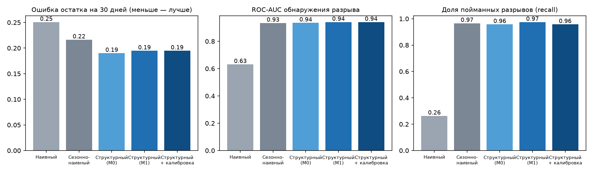
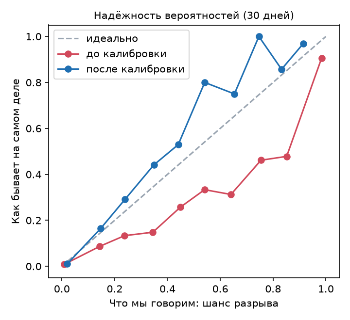

# Бэктест: сравнение подходов (2026-10-24)

Тест: отсечки 2026-03-31 … 2026-08-31, 765 точек у 143 компаний; горизонт 30 дней. Цель — операционный остаток (без денег владельца и разовых операций).

| Подход | Ошибка остатка, медиана rel-MAE | Покрытие P10–P90 | ROC-AUC | PR-AUC | Precision | Recall | За сколько дней знаем, медиана |
|---|---|---|---|---|---|---|---|
| Наивный (остаток не меняется) | 0.251 | 3% | 0.63 | 0.38 | 100% | 26% | 1 |
| Сезонно-наивный (потоки прошлых недель) | 0.216 | 79% | 0.93 | 0.77 | 36% | 97% | 8 |
| Структурный, выручка M0 | 0.190 | 78% | 0.94 | 0.78 | 39% | 96% | 8 |
| Структурный, выручка M1 | 0.195 | 79% | 0.94 | 0.79 | 40% | 97% | 8 |
| Структурный + калибровка шанса | 0.195 | 79% | 0.94 | 0.79 | 43% | 96% | 8 |
| + внешние данные (демо-учётная система) | 0.192 | 71% | 0.95 | 0.79 | 48% | 92% | 8 |

## Итоговая модель (структурная + калибровка) по горизонтам

| Горизонт | rel-MAE | Покрытие P10–P90 | ROC-AUC | Recall | Precision |
|---|---|---|---|---|---|
| 7 дн. | 0.076 | 73% | 0.96 | 91% | 36% |
| 14 дн. | 0.124 | 76% | 0.95 | 93% | 37% |
| 30 дн. | 0.195 | 79% | 0.94 | 96% | 43% |

Разрывы в тесте: 118 из 765 точек (15%); ошибка даты разрыва у пойманных — медиана 2.0 дн.; ошибка суммы нехватки — 0.46 от масштаба остатка.

Уровни риска: жёлтый (шанс ≥10%) — precision 43%, recall 96%; красный (шанс ≥40%) — precision 83%, recall 55%.

## Что дают внешние данные (счета и договоры из учётной системы)

Там, где у бизнеса есть документы: 307 точек (40% теста). Демо-учётная система восстановлена из выписки: модель видит номер, дату и сумму документа, но не дату оплаты.

| Подход | rel-MAE | Покрытие P10–P90 | ROC-AUC | Precision | Recall |
|---|---|---|---|---|---|
| Структурный, выручка M1 | 0.169 | 79% | 0.92 | 28% | 96% |
| + внешние данные (демо-учётная система) | 0.179 | 67% | 0.93 | 44% | 83% |

Ошибка прогноза 30-дневных сумм (WAPE, меньше — лучше):

| Поток | Без внешних данных | С внешними данными |
|---|---|---|
| Оплаты клиентов | 0.181 | 0.168 |
| Оплаты поставщикам | 0.219 | 0.195 |

